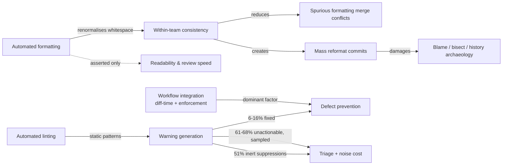

# Is there evidence that automated code formatting and linting improve outcomes?

**Slug:** `code-formatting-linting-evidence` · **Date:** 2026-10-18
**Evidence base:** lead direct sweep + 3 researcher lanes; research files at
`outputs/.drafts/code-formatting-linting-evidence-research-{formatting,linting,costs,direct}.md`
and independent re-checks at `…-lead-checks.md`.

---

## Executive summary

The honest answer is **yes, but only for a narrow, specific set of outcomes — and the popular
version of the claim is not what the evidence supports.** Formatting and linting are two
different interventions, and the evidence diverges sharply between them and between outcome
types.

1. **For program comprehension, the evidence that formatting helps is weak, old, and
   contradictory.** The flagship result everyone cites — Miara et al. 1983, "2-space
   indentation is best" — failed to replicate in a modern eye-tracking study, and an
   odds-ratio aggregation of three further experiments found *no* significant indentation
   effect. A 2023 systematic review of 15 human studies found "many null and contradictory
   results." [11, 14, 15]
2. **For repository hygiene, formatting has its strongest evidence — but in both
   directions.** Divergent formatting demonstrably produces spurious merge conflicts [20] and
   contaminates history (3%–26% of modified lines in ten Java systems were entirely
   non-essential changes) [18, 19]. At the same time, major projects maintain permanent
   `.git-blame-ignore-revs` exclusion lists for their own mass formatting/lint commits
   (scipy: 25 excluded entries; mozilla/gecko-dev: 1,980; django: 21) [25, 26, 27].
   Formatting moves noise; it does not simply remove it.
3. **For defect detection, linting works but detects less than people assume.** The three
   best-known Java bug detectors together caught **27 of 594** historical bugs (4.5%) on an
   extended Defects4J benchmark [32]. Seven open-source SAST tools detected **12.7%** of
   real-world vulnerabilities, with **70.9% remaining undetected** even combined [51]
   *(single study; no independent replication located)*.
4. **The binding constraint is fixing, not detecting.** Reported fix rates are 6–16% for
   FindBugs-class warnings [28, 40] and **8.77%** across 421,976 SonarQube issues [41]. Most
   warnings persist. Roughly half of suppression directives are inert [49].
5. **The one place where an intervention shows a large behavioural effect is workflow
   integration, not the tool.** Meta reported a **70% fix rate** when analysis ran at diff
   time versus **0%** for batch/offline delivery of the same findings [31] — a striking but
   uncontrolled observation. Likewise, Google's *effective* false-positive budget (~5–10%
   not-useful rate) is measured by developer *action*, not by ground truth [28, 29]. This is
   a process-design finding wearing a tooling costume.
6. **The headline benefits in the tool documentation reviewed here are asserted, not
   measured.** gofmt [1], Prettier [2, 3], and Black [4] all state their value in terms of
   readability, diff quality and ending style debates without citing a single measurement.
   Prettier's own maintainers state that "it's really hard to measure demand" and that their
   options "cause a lot of bike-shedding in teams" [3]. The only numbers on those pages are
   adoption counts, formatter speed, and output-equivalence percentages [1, 2, 5, 7].

**Bottom line.** Automated linting has real but modest measured defect-detection value, and
its realised value depends far more on *how* findings are delivered and enforced than on
whether the tool exists. Automated formatting has no reliable measured effect on
comprehension or defect rates; its defensible value is consistency and merge/history-noise
management, and it carries real history-archaeology costs that the same evidence base
documents.

---

## How to read this

**Evidence grades used below.** *Measured* = a study, experiment, or repository analysis with
data. *Observed deployment* = internal industrial reporting of developer actions (real, but
without denominators or ground truth). *Asserted* = a claim in docs/blogs with no data.
*Inference* = our reasoning across sources, labelled as such.

**Degraded-mode note (required disclosure).** This run's configured web-search provider (Exa)
returned HTTP 429 for the entire session; Brave, Tavily, Jina, Parallel and SearXNG had no
credentials or URL configured; DuckDuckGo worked but rate-limited, and one fallback provider
was bot-blocked. Semantic Scholar's anonymous pool repeatedly returned 429, and OpenAlex's
anonymous daily budget was exhausted mid-run. Consequently: some primary PDFs were read via
author/institution mirrors rather than publisher sites; several sources were accessible only
at abstract/TLDR level, and every such case is flagged in place; and ACM/IEEE `doi.org` links
return HTTP 403 (ACM) / HTTP 202 (IEEE) to this client (bot block, not dead links). These
limits are itemised in the research files and in the provenance sidecar.

**Access statement (precise form).** No claim below rests on a source that could not be
accessed in at least abstract/TLDR form, and where access stopped at the abstract or TLDR the
text says so. Two claims rest on secondary reports of a primary source whose full text was
bot-blocked (Miara et al. [9]); both are marked.

---

## Q1 — Does formatting change human comprehension? (Evidence: weak, contradictory, mostly null)

The literature here is ~40 years old and methodological quality varies enormously.

| Study | Design | Direction | Our confidence |
|---|---|---|---|
| Miara et al. 1983 (CACM) [9] | Between-subjects, novices, Pascal, 0/2/4/6 spaces | 2-space best (inverted-U) per the SLR [14]; a second lane reads the same paper as 2–4 spaces best | **Medium** — full text inaccessible (publisher bot-block); direction taken from two independent secondary reports that agree on "moderate is better" but differ on the exact optimum [11, 14] |
| Kesler et al. 1984 [10] | Three groups *(inferred from the TLDR's "better than the other two groups")* | Departmental standard group better | **Low** — TLDR only, no n, no metric |
| Bauer et al. 2019 (ICPC) [11] | Non-exact replication, Java, within-subjects, 22 analysed participants, eye tracking, 0/2/4/8 spaces | **Null**: correctness p=0.36, response time p=0.72, η²p=0.006; power analysis implied n≈304 for a small effect | **High** — full text read |
| Morzeck et al. 2023 (ICSOFT) [12]; Hanenberg et al. 2024 (EMSE) [13] | RCTs on generated if-statement stimuli, reaction time | **Large positive** for indentation | **Medium-low** — abstracts only; populations and magnitudes not accessible |
| Ribeiro et al. 2023 (EMSE) [15] | Three primary studies by the same group, aggregated by odds ratio | **Null** for indentation spacing and code size at α=5% | **Medium-high** — abstract read directly |
| Oliveira et al. 2023 (JSS, SLR) [14] | Screened 4,914 documents → 15 human-centric papers; 13 elements / 33 levels / 27 comparisons | Mixed; "many null and contradictory results"; 5/15 papers ≥30 years old | **High** — full text read |
| Roberto et al. 2024 (SBES) [16] | Eye tracking, 32 Python novices, 4 PEP8 rules | **Both directions**: one rule violation raised eye regressions 70%; another rule performed *better* when violated — while subjects still preferred the compliant version | **High** — full text read |

**What this means.** The specific folklore — "consistent indentation makes code easier to
understand" — is not established for indentation *level*. The best-controlled modern
replication found nothing [11], and the aggregation found nothing [15]. The studies that do
find large effects use generated micro-stimuli and reaction-time measures, which may not
transfer to real code [12, 13]. The most defensible statement is that *some* formatting
properties have small, context-dependent measured effects, and that a large part of what teams
argue about has never been shown to matter. Miara's 1983 abstract concedes that "many studies
do not back this up." [9]

**One rule matters for tools specifically.** The SLR flags "appropriate use of indentation
with blocks" as statistically better, while "formatting layout" comparisons were null [14] —
i.e., a formatter that renormalises indentation is doing something with weak support, while
the property that did show support (block structure) is not something a whitespace formatter
changes.

**Machines are a different audience.** Removing formatting from code input changed LLM
performance negligibly while cutting input tokens ~24.5% (4 languages, 10 LLMs, Pan et al.
2025) [17]. Formatting's comprehension value, if any, is human-side — relevant when code
review and onboarding are LLM-assisted.

---

## Q2 — Does formatting improve software evolution hygiene? (Strongest evidence, both directions)

This is where formatting has its clearest measured footprint — and it is not a simple win.

**Formatting noise demonstrably contaminates history.**
- Kawrykow & Robillard (ICSE 2011 [18]; 2012 thesis [19]): across 30,000+ change sets in ten
  open-source Java systems, **3%–26% of all modified code lines** and **2%–16% of all method
  updates** consisted entirely of non-essential (formatting/whitespace/task-unrelated)
  modifications. Removing them reduced false-positive recommendations from a downstream
  association-rule miner. Because bug-finding and defect-prediction tools consume diffs, this
  is direct contamination of downstream results.
- Herzig & Zeller (MSR 2013) [21]: across five OSS Java projects, **≥16.6% of source files
  were incorrectly associated with bug reports** — the tangled-change problem that formatting
  commits help create.
- Shen et al. (TOSEM 2022) [20], 208 Java projects / 117,218 merge scenarios: **15,886
  textual conflicts**. The paper names the mechanism exactly — "when two branches reformat the
  same line in divergent ways … git-merge reports a textual conflict even though such a
  conflict is unimportant" — and found 7 of 320 manually analysed true conflicts were
  semantically-equivalent-but-textually-different (main formatting), which developers resolved
  by "probably randomly" picking a branch. 65 of 385 conflicts were pure line-merge false
  positives from adjacent-line edits.

**But mass formatting commits create their own measurable cost.** The strongest evidence is
that projects permanently exclude their own formatter/lint commits from blame:
`.git-blame-ignore-revs` in scipy lists **25** excluded entries ("Adopt ruff linter and 'lint
everything'", "Whitespace clean up in stats", "Blanket noqa clean up") [25]; django lists
**21** [26]; mozilla/gecko-dev lists **1,980** entries (non-comment hash lines, not distinct
commits) including "Exterminate CR+LF line endings" and "Reduce indentation from 4 to 2
spaces" [27]. Git and GitHub both ship first-class support for this (`--ignore-rev`,
`blame.ignoreRevsFile`, and the GitHub blame-ignore view) [23, 24]. This is a *revealed* cost:
the maintainers judged the history damage significant enough to configure a permanent
mitigation for every contributor.

**What is missing.** Our search found **no** controlled study measuring formatter-induced
churn inflation, `git bisect` breakage, or blame-coverage loss as a primary outcome. The
evidence is exclusion lists [25, 26, 27], tooling support [23, 24], and practitioner accounts.
Treat the *magnitude* of these costs as unmeasured — a real gap, not a refuted claim.

**Structured-merge corroboration.** Spork (TSE 2022) [22], evaluated by replaying **1,740
real-world file merges from 119 projects**, is designed around preserving formatting precisely
because line-based merge cannot exploit structure and existing structured-merge tools tend to
reformat merged code. The tooling ecosystem itself treats "the merge reformatted my code" as a
first-class harm.

**Verdict for Q2.** Formatting enforcement plausibly reduces *within-team* formatting
divergence (the mechanism behind spurious conflicts) [20], but the net effect on history
quality is a trade: noise moves from every diff into a small number of mass commits that must
then be excluded from blame [25, 26, 27]. No study quantifies the net.

---

## Q3 — Does linting/static analysis improve defect outcomes? (Real, modest, and mostly unfixed)

### 3.1 Detection yield is modest when measured against ground truth

| Study | Measurement | Result |
|---|---|---|
| Habib & Pradel, ASE 2018 [32] | Error Prone + Infer + SpotBugs on extended Defects4J (15 projects, 594 bugs) | **27/594 = 4.5% detected**; per-tool 0.84%–3%; 95.5% undetected |
| Thung et al., ASE 2012 [33] | 200 manually analysed *field* defects (Lucene, Rhino, AspectJ) with FindBugs + PMD + JLint | Lucene 35.7% fully identified / 50% missed; Rhino 95% fully; AspectJ 70.4% fully / 1.9% missed |
| Wang et al., ICPC 2022 [34] | Differential testing of paired rules, 4 tools, 2,728 projects | 7,633 rule inconsistencies; **46 bugs found in the analyzer rules themselves** (8 causing false positives, 38 causing missed true bugs) |
| SAST comparisons, 2023–2024 [51, 53] | Seven open-source SAST tools vs real-world vulnerabilities | **12.7% detected; 70.9% remain undetected even combined** [51] *(single study)*; individual 11.2%–26.5%; four combined 38.8% [53] |
| Shen et al., ISSTA 2025 [42] | CodeQL on 258 embedded projects | 709 true defects; **34% false-positive rate** (driven by a few outlier rules/projects); of the 709 true defects, 535 (75%) were likely security vulnerabilities |

Note the shape of this: the tools are neither useless nor close to complete, and *the
analyzers themselves are buggy at a measurable rate* [34]. Detection yield also depends
heavily on which class of defect you ask about — the SAST class is the weakest, though that
conclusion rests on one comparison study [51] plus one corroborating tool evaluation [53].

### 3.2 Fix rates are low, and persistence is the norm

| Study | Population | Fix rate |
|---|---|---|
| Google "Fixit" week, 2009 (reported in CACM 2018) [28] | 3,954 reviewed FindBugs warnings (42% of 9,473) | **16%** actually fixed; 44% produced a bug report |
| Kim & Ernst, ESEC/FSE 2007 [40] | 3 OSS projects, 1–4 years | **6%, 9%, 9%** of warnings removed by fix-changes; "about 90% of warnings either remain or are removed during non-fix changes" |
| Marcilio et al., ICPC 2019 [41] | 421,976 SonarQube issues, 246 projects, 4 organisations | **8.76–8.77%** fixed; median fix interval 18.99 days (ASF 6.67); 29% fixed after >1 year |

The count of warnings raised is therefore roughly **6–17×** the count fixed (the inverse of
the 16% / 6–9% / 8.8% rates above) *(our arithmetic, not a cited statistic)*. Two cautions
apply: a fixed warning is not necessarily a prevented defect, and a prevented defect need not
have had a warning. Even so, the calibration gap is the most important number in the linter
literature, and it did not appear in any vendor documentation we reviewed.

### 3.3 The strongest positive signal is workflow integration, not the tool

- **Meta, CACM 2019 [31]:** Infer "has seen over 100 thousand reported issues fixed by
  developers before code reaches production"; Zoncolan detected "43.3% of the severe security
  bugs" on a 100-million-line codebase with an "action rate … above 80%" and ~11 observed
  misses. Most striking: **"the diff time deployment saw a 70% fix rate, where a more
  traditional 'offline' or 'batch' deployment … saw a 0% fix rate."** [31]
- **Google, CACM 2018 [28]:** ~50,000 code-review changes analysed per day; "Reviewers clicked
  'Please Fix' more than 5,000 times per day, and authors applied the automated fixes
  approximately 3,000 times per day"; reviewers clicked "Not useful" ~250 times/day; headline
  claim that infrastructure "prevents hundreds of bugs per day."
- **Tricorder, ICSE 2015 [29]:** not-useful rate typically ~5% (under 4% excluding analyzers
  on probation); best analyzers 0–3%; bug-filing rate per NOT USEFUL click 10–60%; >18K users
  clicked PLEASE FIX in 2014. The authors warn these click counts are "an imperfect measure of
  analyzer quality."

**What these deployments do and do not measure (important).** They measure *developer actions*
inside one monorepo — fix clicks, applied autofixes, bug reports filed — plus a self-reported
perceived-severity survey (74% of compile-time issues deemed "real problems" vs 21% of
checked-in-code issues) [28]. They do **not** report analyzer recall, escaped-defect
reduction, or production-incident reduction, and "hundreds of bugs per day" has no
denominator or ground-truth validation [28]. The 70%-vs-0% contrast is one striking
observation, not a controlled experiment [31].

Correction to a common citation: the Meta Infer paper (NFM 2015) [30] is **largely
qualitative**; we found **no** bug counts, false-positive rates, or fix rates in the
accessible full text. Any yield figure attributed to it should be treated as unverified.

### 3.4 Outcome-level (defect density / escapes) evidence is correlational or modelled

- **Trautsch et al., EMSE 2020 [39]** — the largest longitudinal study found (54 Apache
  projects, 112,266 commits, 193 PMD rules, up to 17 years): the effect of PMD's presence on
  *warning-removal trends* was "small and not statistically significant." Years with PMD had
  lower median defect density (0.895 vs 1.677, Mann-Whitney p = 7.2559e-08, effect size
  0.26943, i.e., small), but the authors explicitly disclaim causality: it "may not
  necessarily be a result of using PMD … but could also be an effect of the developers keeping
  the codebase healthy."
- **Nichols (SEI), 2020 [38]** — 35 instrumented industrial projects: modelled
  single-technique static-analysis defect-removal yields "somewhere in the 15%–35% range"; a
  company-average **11% reduction in escapes**; find-and-fix rates "among the fastest of all
  removal techniques." This is modelled, excludes licensing/training/fielded-defect costs, and
  one organisation measured 10%.
- **Johansson et al., ICPC 2024 [37]** — 127 C++ projects, Bayesian analysis: stricter
  compiler warning usage **correlated** with better quality on some metrics (notably critical
  issues). Observational.
- **Kudrjavets et al., ICSE-SEIP 2022 [36]** — the evidence review itself: "Existing research
  and empirical data about the benefits of fixing compiler warnings is minimal. Most of the
  data comes from grey literature … or anecdotal knowledge," and they could find only *one*
  paper investigating the warnings–defects correlation.

### 3.5 Where an ROI number does exist, it is small, old, and security-specific

A 2008 PLAS case study [44] on three mature products with known vulnerabilities estimated "an
average of 17% cost savings would have been possible if the static analysis tool was used,"
with 59 new vulnerabilities found. Single case study, three products, value estimated from
customer-reported failures. Vendor ROI claims encountered (SonarSource "strong ROI" [45];
Testomat.io "production bugs decrease 60% to 80%" at 12 months [46]) cite **no method, sample,
or dataset** and are recorded as asserted, not measured.

---

## Q4 — What do linting/formatting cost developers? (Measured, and it undercuts the FP narrative)

- **Suppression is common, growing, and mostly not about false positives.** Liargkovas et al.
  (2023) [48] analysed 1,425 Java projects: 13% ship a suppression filter file, 7% use
  suppression annotations; in manually coded samples, false positives were only **5%** of
  configuration suppressions and **4%** of annotation suppressions, while **68% / 61% were
  "unactionable."** The paper concludes effort "would be better invested in improving
  reporting, automated error correction, and guidance … rather than increasing tool accuracy."
  Hu et al. (FSE 2025) [49]: 7,357 suppressions in 46 Python projects (≈one per six files),
  **50.8% of which affect no warning at all** (practically useless, and capable of hiding
  *future* warnings).
- **Distrust is driven by noise, staleness and perceived subjectivity, not by raw counts.**
  Johnson et al. (ICSE 2013, 20 interviews) [47]: false positives and *how warnings are
  presented* are the barriers — while participants still felt use is beneficial. Vassallo et
  al. (EMSE 2020; 56 surveyed, 11 interviews, 176 projects) [50]: warnings are "most of the
  time … irrelevant for the actual contexts," developers disable warnings on inherited code,
  some "do not trust the results," and configuration is "very time-consuming" (78% use no
  context-specific configuration).
- **Security linters are the weakest class.** Seven open-source SAST tools detected 12.7% of
  real-world vulnerabilities (70.9% remain undetected even combined) [51] *(single study; no
  independent replication located)*. One controlled Java evaluation found SAST tools exhibit
  **high precision but short recall** — directly contradicting the "false-positive epidemic"
  framing for that tool class [52]. Our search found **no** study measuring whether SAST
  adoption reduces *production security incidents*.
- **Adoption is shallow.** A 1,263-developer survey [54]: only **20%** used SAST tools; among
  users, 59% did not use multiple tools, 54% did not configure one, and 40% did neither.
  Beller et al. (SANER 2016) [35]: among 122 projects, 36% used one analyzer and 23% more than
  one; usage was "sporadic"; fewer than half of analyzer-using projects enforced a regression
  policy on new code.
- **Warning-triage cost is non-trivial.** Beller et al. [35] cite prior work of ~40 warnings
  per 1,000 LOC, up to 50 false positives per accurate warning, and 3–8 minutes to decide
  whether a warning is real. (These are secondary citations inside Beller, not Beller's own
  measurement.)
- **Warning "fatigue" as desensitisation is asserted, not measured.** Our search could not
  retrieve a study that measures response-rate decay over exposure. The nearest measured
  proxies are suppression rates and their growth over time [48, 49].

---

## Q5 — Adjacent evidence: static typing (clearly *not* linting, but routinely bundled with it)

- **Gao, Bird & Barr (ICSE 2017) [55]:** counterfactual "what-if" experiment over 400 public
  already-fixed JavaScript bugs. Both Flow and TypeScript 2.0 detect **15%** (95% CI
  [11.5%, 18.5%]); combined, 63 bugs, of which 7 (11%) were field bugs. The authors stress
  this is conservative for private development and cannot measure bugs that never became
  public.
- **Di Grazia & Pradel (FSE 2022) [56]:** 1,123,393 commits across 9,655 Python projects —
  **78.3% of commits contain statically detectable type errors but are integrated anyway**;
  ~6 type errors per 1,000 LOC. *Inference (labelled):* this is field evidence that detection
  ≠ fixing even when the checker is unambiguous, mirroring the linter fix-rate findings.
- Python annotation-defect taxonomy (SANER 2023, 19.5M LOC scanned) [57]: a repair prototype
  generated suggestions for 82/110 (74.55%) defects — a *suggestion* rate, not a prevention
  rate.
- A 2026 preprint [58] reports type errors at 12.4% of the bug taxonomy in 16 TypeScript repos
  vs a ~33% JavaScript baseline from a different study. This is a cross-study comparison
  against different projects and years; treat as suggestive only.

**Interpretation:** "more machine checking" reliably *detects* more; the 15% [55] and 4.5%
[32] figures show the ceiling is far below "prevents most bugs."

---

## Q6 — What the tools claim vs what has been measured

| Claim | Source | Data offered |
|---|---|---|
| gofmt code is "easier to write/read/maintain", "uncontroversial: never have a debate about spacing or brace position ever again" [1] | Go blog [1] | None; the one number is "about 70% of them are formatted according to gofmt's rules" — a *conformance* survey with no stated methodology or date |
| "By far the biggest reason for adopting Prettier is to stop all the ongoing debates over styles." [2, 3] | Prettier docs [2, 3] | None. Same page concedes "The debates over styles just turn into debates over which Prettier options to use" and "it's really hard to measure demand" [3] |
| "Black makes code review faster by producing the smallest diffs possible" [4] | Black docs [4] | None (one anecdotal testimonial about keystrokes) |
| Ruff formatter consistency [5] | Ruff docs [5] | "> 99.9% of lines are formatted identically" vs Black on Django/Zulip — *output equivalence*, not downstream benefit |
| Google allows "up to 10% effective false positives" [28] | Sadowski et al., CACM 2018 [28] | The paper itself footnotes the threshold "was initially chosen by the first author somewhat arbitrarily" |
| ESLint docs on inline rule disabling [6] | ESLint docs [6] | Framed as "Use with Caution"; ships unused-disable-directive reporting by default — tooling acknowledging a problem that the literature then quantifies at ~50% dead [49] |
| "Review no more than 200 to 400 LOC at a time" [8] | SmartBear vendor page [8] citing "a SmartBear study of a Cisco Systems team" | No sample size or methodology disclosed on the page |

**Pattern (this is the find).** None of the six tool-documentation pages reviewed measures
comprehension, defect rate, review latency, or merge conflicts [1, 2, 3, 4, 5, 6]. The
measured numbers on those pages are adoption counts (gofmt ~70% conformance [1]; ESLint
42.7M → 70.7M weekly npm downloads through 2025 [7]), formatter speed [2], and
Black-compatibility percentages [5]. The argument for adoption is preference, culture and
consistency — which is exactly the outcome class with the weakest measurement behind it.

---

## Answers by outcome class (the core deliverable)

| # | Outcome | Intervention | Verdict | Strongest evidence | Confidence |
|---|---|---|---|---|---|
| O1 | Comprehension / readability | Formatting | **Not supported** for indentation level; element-specific at best | Bauer et al. 2019 null replication [11]; Ribeiro et al. 2023 null aggregation [15]; SLR's "many null and contradictory results" [14] | High (that it's unsupported), Low (that any specific style is optimal) |
| O2 | Defect rate / escaped defects | Linting | **Supported but modest**, and mostly unproven at the outcome level | 4.5% benchmark detection [32]; 12.7% SAST detection (single study) [51]; 15–35% modelled yield and 11% modelled escape reduction (SEI) [38]; small correlational defect-density effect (Trautsch) [39] | Medium |
| O2 | Defect rate | Formatting | **No reliable evidence found**; one TLDR-only study set aside | — | — |
| O3 | Merge conflicts / diff noise | Formatting | **Supported**: divergent formatting creates spurious conflicts and non-essential change noise | Shen et al. 2022 (15,886 conflicts; named formatting mechanism) [20]; Kawrykow & Robillard (3–26% non-essential lines) [18, 19] | Medium-high |
| O3 | History/blame quality | Formatting | **Cost is real and revealed**; net effect unmeasured | scipy 25 / django 21 / gecko-dev 1,980 excluded entries [25, 26, 27]; `git blame --ignore-rev` tooling [23, 24] | Medium (cost exists), Low (magnitude) |
| O4 | Review effort / productivity | Formatting | **Asserted only** | No measured study found [2, 3, 4] | — |
| O4 | Triage burden / distrust | Linting | **Cost is measured** | 68%/61% unactionable suppressions [48]; 50.8% inert suppressions [49]; 78% no context config [50]; 3–8 min per warning (secondary) [35] | Medium |
| O4 | Fix behaviour | Linting | **Plausibly dominated by workflow integration** | Meta 70% fix rate at diff time vs 0% batch (single uncontrolled observation) [31]; Google click/apply counts [28, 29] | Medium |
| O5 | Fewer style debates | Formatting | **Asserted, with a documented counter-mechanism** | Prettier docs: debates become option debates; options cause "bike-shedding" [3] | Medium (that it's asserted) |
| O5 | Warning-fatigue reduction | Linting | **Not measured**; suppression growth is the nearest proxy | Suppression counts rising over time [48, 49] | Low |
| O6 | CI/runtime cost of tooling | Both | **Vendor-reported, not independently measured** | Formatter speed claims [2]; ESLint multithreaded linting, 30% to >300% on large projects (vendor's own figures) [7] | Low |

---

## Disagreements and caveats

1. **False positives vs false negatives is an unresolved framing fight.** Google's deployment
   treats effective false positives as the key budget (10% policy, ~5% observed not-useful)
   [28, 29]. But Liargkovas et al. find false positives to be a *minor* driver of suppression
   (4–5%) [48], and the SAST literature finds the bigger problem is recall (12.7% detected,
   70.9% missed) [51]. Both can be true for different tool classes and different defect types.
2. **Benchmark precision ≠ field precision.** Google's <10% "effective false positive" is a
   developer-action budget [28]; CodeQL's 34% is a curated-corpus adjudication [42]; the CodeQL
   refinement preprint's 81.8% false-positive removal is on reviewed CVE instances [43]. These
   numbers must never be tabulated together.
3. **The industrial deployment numbers cannot be generalised.** They come from two huge
   monorepos with dedicated analysis infrastructure, incentives, and (in Google's case) a
   culture of review-time checks [28, 29, 31]. The 70%-vs-0% result is a *single observation*
   [31]; treat the direction as plausible and the magnitude as unverified.
4. **The SAST yield rests on one comparison study.** The 12.7% / 70.9% pair is from a single
   ESEC/FSE 2023 evaluation [51]; the corroborating tool comparison [53] uses a different
   corpus and reports 11.2%–26.5% per tool. No independent replication was located, so treat
   "the SAST class is the weakest" as a hypothesis supported by two studies, not a settled
   ranking.
5. **Two conflicting readings of the indentation literature are both defensible** (null [11,
   15] vs large-positive [12, 13]). The reconciliation the design differences suggest — effects
   appear only for longer/skippable code — is a hypothesis proposed by the null-replication
   authors [11], not a demonstrated moderator.
6. **Preprints are labelled.** The CodeQL false-positive refinement study [43] and the
   TypeScript bug-taxonomy study [58] are arXiv preprints and are not peer-reviewed.
7. **Duplicate reading as an internal check.** Sadowski et al. 2018 [28] was independently read
   by two researchers and the numbers agreed (10% policy; Fixit 16% fix rate) — used as a
   consistency check, not as two independent sources.

---

## Open questions and gaps (real gaps, not failed searches)

1. **No measured study of formatter-induced churn, blame degradation, or bisect breakage.**
   The costs are revealed by exclusion lists [25, 26, 27], not quantified.
2. **No measured study of the effect of "formatting-only commits" on review effort.**
3. **No peer-reviewed adoption study for gofmt, Prettier, or Black**, and no adoption-rate
   measurement beyond gofmt's self-reported 70% [1].
4. **No study measuring production-incident or escaped-defect reduction attributable to
   linting with a proper denominator.** The closest are a correlational defect-density result
   (Trautsch [39], small effect, causality disclaimed) and a modelled escape reduction (SEI
   [38], 35 projects).
5. **No direct measurement of developer warning-fatigue (response decay over exposure).**
6. **Modern JS/TS/Go tooling (ESLint rule efficacy, Ruff, Clippy, Roslyn analyzers) has little
   to no peer-reviewed quantitative evidence.** The quantitative literature is dominated by
   Java analysers, FindBugs/SonarQube, and enterprise SAST [32, 35, 39, 42, 51].
7. **The net accounting is missing:** formatting is claimed to reduce diff noise [20], yet its
   own mass commits are then excluded from blame [25, 26, 27]. Nobody has measured the net
   change in history-archaeology cost.
8. **An experiment that would settle Q1/Q3 properly:** pre-registered, powered, on real
   multi-hundred-line code, with semantics-vs-syntax comprehension instruments separated (the
   2026 ASE proxy-reliability paper [59] shows syntax-question proxies are unreliable), and —
   for linting — a diff-time-vs-batch randomised rollout with an escaped-defect endpoint rather
   than a click endpoint.

**What we would not say.** We would not say "formatters make code more readable" (not
established [11, 14, 15]), "linters find most bugs" (they find 4.5–13% on the best available
ground truth [32, 51]), or "linting doesn't work" (detection is real, and diff-time
integration changes fix behaviour dramatically [31]). The defensible claim is narrower and
more useful: **linting pays off in proportion to how tightly findings are wired into the
developer's active workflow, and formatting's measurable value is consistency management, not
comprehension.**

---

## Sources

All URLs were fetched on 2026-10-18. Open mirrors and raw artifacts returned HTTP 200.
`doi.org` targets under `10.1145/…` return HTTP 403 and under `10.1109/…` return HTTP 202 to
automated clients — a publisher bot block, not a dead link; each such record resolves via DOI
metadata (title, year and first author matched against Crossref) and an open mirror is given
where the research files recorded one. Cited papers' DOIs/arXiv IDs were cross-checked against
Crossref and the arXiv API, and (where the anonymous budget allowed) the research files'
OpenAlex/Semantic Scholar records. Source-lane tags: **T1** = formatting, **T2** = linting,
**T3** = costs, **S1** = lead direct sweep.

**Tool documentation and vendor claims**

1. *go fmt your code* — The Go Blog. https://go.dev/blog/gofmt (S1) — live.
2. Prettier — *Why Prettier?* https://prettier.io/docs/why-prettier (T3) — live.
3. Prettier — *Option Philosophy.* https://prettier.io/docs/option-philosophy (T3/S1) — live.
4. Black — *The uncompromising code formatter* (docs home). https://black.readthedocs.io/en/stable/ (T3) — live.
5. Ruff — *The Ruff Formatter.* https://docs.astral.sh/ruff/formatter/ (T3) — live.
6. ESLint — *Configure Rules.* https://eslint.org/docs/latest/use/configure/rules (T3) — live.
7. ESLint — *ESLint's 2025 year in review.* https://eslint.org/blog/2026/01/eslint-2025-year-review/ (S1) — live.
8. SmartBear — *Best Practices for Code Review.* https://smartbear.com/learn/code-review/best-practices-for-peer-code-review/ (T3) — live (vendor page).

**Q1 — comprehension**

9. Miara, Musselman, Navarro, Shneiderman — *Program indentation and comprehensibility* — CACM 26(11), 1983. https://doi.org/10.1145/182.358437 (T1; abstract quote and direction read via secondary reports) — resolves via DOI metadata (Crossref: Miara, 1983); publisher returns HTTP 403 to automated fetch.
10. Kesler et al. — *The Effect of Indentation on Program Comprehension* — Int. J. Man-Machine Studies, 1984. https://www.semanticscholar.org/paper/ae556b4409af535acb9482c7e83d5dbee7b3aeb7 (T1) — metadata/TLDR only.
11. Bauer, Siegmund, Peitek, Hofmeister, Apel — *Indentation: Simply a Matter of Style or Support for Program Comprehension?* — ICPC 2019. https://www.infosun.fim.uni-passau.de/publications/docs/Bauer19.pdf (DOI 10.1109/ICPC.2019.00033) (T1) — live PDF.
12. Morzeck, Hanenberg, Werger, Gruhn — *Indentation in Source Code: A Randomized Control Trial…* — ICSOFT 2023. https://doi.org/10.5220/0012087500003538 (T1) — resolves via DOI metadata (Crossref: Morzeck, 2023).
13. Hanenberg, Morzeck, Gruhn — *Indentation and reading time…* — EMSE 29, 2024. https://doi.org/10.1007/s10664-024-10531-y (T1) — resolves via DOI metadata (Crossref: Hanenberg, 2024).
14. Oliveira, Madeiral et al. — *A Systematic Literature Review on the Impact of Formatting Elements on Code Legibility* — JSS 2023. https://arxiv.org/abs/2208.12141 (T1) — live (arXiv; Crossref: Oliveira, 2023, JSS).
15. Ribeiro, dos Santos, Travassos — *On the Investigation of Empirical Contradictions…* — EMSE 28(6), 2023. https://doi.org/10.1007/s10664-023-10360-5 (T1) — resolves via DOI metadata (Crossref: Ribeiro, 2023).
16. Roberto, Gheyi, Costa, Ribeiro — *Assessing Python Style Guides: An Eye-Tracking Study with Novice Developers* — SBES 2024. https://arxiv.org/abs/2408.14566 (T1) — live.
17. Pan et al. — *The Hidden Cost of Readability: How Code Formatting Silently Consumes Your LLM Budget* — arXiv 2508.13666, 2025. https://arxiv.org/abs/2508.13666 (T1) — live.

**Q2 — evolution hygiene**

18. Kawrykow & Robillard — *Non-essential changes in version histories* — ICSE 2011. https://doi.org/10.1145/1985793.1985842 (T1) — resolves via DOI metadata (Crossref: Kawrykow, 2011); publisher returns HTTP 403 to automated fetch.
19. Kawrykow — *Enabling precise interpretations of software change data* — McGill thesis, 2012. https://escholarship.mcgill.ca/concern/theses/sn00b2873 (T1) — live.
20. Shen, Gulzar, He, Meng — *A Characterization Study of Merge Conflicts in Java Projects* — ACM TOSEM 32(2), 2022 (Crossref issue year 2023). https://doi.org/10.1145/3546944 (open mirror: https://vtechworks.lib.vt.edu/bitstream/10919/112057/1/3546944.pdf) (T1) — resolves via DOI metadata (Crossref: Shen); publisher returns HTTP 403 to automated fetch; mirror live.
21. Herzig & Zeller — *The impact of tangled code changes* — MSR 2013. https://doi.org/10.1109/MSR.2013.6624018 (T1) — resolves via DOI metadata (Crossref: Herzig, 2013); IEEE returns HTTP 202 to automated fetch.
22. Larsén, Falleri, Baudry, Monperrus — *Spork: Structured Merge for Java with Formatting Preservation* — IEEE TSE 49(1), 2022. https://arxiv.org/abs/2202.05329 (T1) — live.
23. Git — *git-blame* manual (`--ignore-rev`, `--ignore-revs-file`, `blame.ignoreRevsFile`). https://git-scm.com/docs/git-blame (T1/T3) — live.
24. GitHub Docs — *Viewing and understanding files* ("Ignore commits in the blame view"). https://docs.github.com/en/repositories/working-with-files/using-files/viewing-a-file (T1/T3) — live.
25. scipy — `.git-blame-ignore-revs` (raw; 25 non-comment entries counted by the lead). https://raw.githubusercontent.com/scipy/scipy/main/.git-blame-ignore-revs (T3) — live raw artifact.
26. django — `.git-blame-ignore-revs` (raw; 21 entries counted). https://raw.githubusercontent.com/django/django/main/.git-blame-ignore-revs (T3) — live raw artifact.
27. mozilla/gecko-dev — `.git-blame-ignore-revs` (raw; 1,980 non-comment lines counted). https://raw.githubusercontent.com/mozilla/gecko-dev/master/.git-blame-ignore-revs (T3) — live raw artifact.

**Q3 — linting and defect outcomes**

28. Sadowski, Aftandilian, Eagle, Miller-Cushon, Jaspan — *Lessons from building static analysis tools at Google* — CACM 61(4), 2018. https://doi.org/10.1145/3188720 (open mirror: https://6826.csail.mit.edu/2020/papers/google-analysis-cacm.pdf) (T2) — resolves via DOI metadata (Crossref: Sadowski, 2018); publisher returns HTTP 403 to automated fetch; mirror live.
29. Sadowski, van Gogh, Jaspan, Söderberg, Winter — *Tricorder: Building a Program Analysis Ecosystem* — ICSE 2015. https://static.googleusercontent.com/media/research.google.com/en/us/pubs/archive/43322.pdf (T2) — live PDF.
30. Calcagno, Distefano, Dubreil, Gabi, Hooimeijer, Luca, O'Hearn, Papakonstantinou, Purbrick — *Moving Fast with Software Verification* — NFM 2015. https://doi.org/10.1007/978-3-319-17524-9_1 (T2) — resolves via DOI metadata (Crossref: Calcagno, 2015).
31. Distefano, Fähndrich, Logozzo, O'Hearn — *Scaling static analyses at Facebook* — CACM 62(8), 2019. https://cseweb.ucsd.edu/~dstefan/cse227-spring20/papers/distefano:scaling.pdf (DOI 10.1145/3338112) (T2) — live PDF.
32. Habib & Pradel — *How many of all bugs do we find? A study of static bug detectors* — ASE 2018. https://andrewhabib.org/publications/ase18-StaticCheckers.pdf (DOI 10.1145/3238147.3238213) (T2) — live PDF.
33. Thung, Lucia, Lo, Jiang, Rahman, Devanbu — *To what extent could we detect field defects?* — ASE 2012. http://www.mysmu.edu/faculty/lxjiang/papers/ase12FNStudy.pdf (DOI 10.1145/2351676.2351685) (T2) — live PDF.
34. Wang, Huang, Wang, Wang — *Find bugs in static bug finders* — ICPC 2022. DOI 10.1145/3524610.3527899; preprint (titled *An Approach to Detecting Bugs in Pattern-Based Bug Detectors*): https://arxiv.org/pdf/2109.02245 (T2) — resolves via DOI metadata (Crossref: Wang, 2022); preprint live.
35. Beller, Bholanath, McIntosh, Zaidman — *Analyzing the State of Static Analysis: A Large-Scale Evaluation in Open Source Software* — SANER 2016. https://azaidman.github.io/publications/bellerSANER2016.pdf (DOI 10.1109/SANER.2016.105) (T2) — live PDF.
36. Kudrjavets, Kumar, Nagappan, Rastogi — *The Unexplored Terrain of Compiler Warnings* — ICSE-SEIP 2022. https://arxiv.org/pdf/2201.10599 (DOI 10.1145/3510457.3513057) (T2) — live.
37. Johansson, Holmberg, Gomes, Leitner — *The Impact of Compiler Warnings on Code Quality in C++ Projects* — ICPC 2024. https://odr.chalmers.se/server/api/core/bitstreams/5021c179-4512-44d2-bdb9-bf44b76abd3c/content (DOI 10.1145/3643916.3644410) (T2) — live PDF.
38. Nichols (SEI) — *The Cost and Benefits of Static Analysis During Development* — 2020. https://arxiv.org/pdf/2003.03001 (T2) — live.
39. Trautsch, Herbold, Grabowski — *A Longitudinal Study of Static Analysis Warning Evolution and the Effects of PMD on Software Quality in Apache Open Source Projects* — EMSE 25(6), 2020. https://arxiv.org/pdf/1912.02179v2 (DOI 10.1007/s10664-020-09880-1) (T2) — live.
40. Kim & Ernst — *Which warnings should I fix first?* — ESEC/FSE 2007. https://homes.cs.washington.edu/~mernst/pubs/prioritize-warnings-fse2007.pdf (DOI 10.1145/1287624.1287633) (T2) — live PDF.
41. Marcilio, Bonifácio, Monteiro, Canedo, Luz, Pinto — *Are Static Analysis Violations Really Fixed? A Closer Look at Realistic Usage of SonarQube* — ICPC 2019. https://dvmarcilio.github.io/papers/icpc2019.pdf (DOI 10.1109/ICPC.2019.00040) (T2) — live PDF.
42. Shen, Pillai, Yuan, Davis, Machiry — *Finding 709 Defects in 258 Projects: An Experience Report on Applying CodeQL to Open-Source Embedded Software* — ISSTA 2025. https://arxiv.org/pdf/2310.00205 (T2) — live.
43. Sajadi et al. — *An Empirical Analysis of CodeQL False Positives and Query Refinements for Java Vulnerabilities* — arXiv preprint 2609.04535, 2026. https://arxiv.org/pdf/2609.04535 (T2) — live; not peer-reviewed.
44. Baca & Carlsson — *Evaluating the cost reduction of static code analysis for software security* — ACM SIGPLAN PLAS 2008. Full text: https://bth.diva-portal.org/smash/get/diva2:836174/FULLTEXT01.pdf (DOI 10.1145/1375696.1375707) (T2) — full text live; DOI returns HTTP 403 to automated fetch.
45. SonarSource — *Automated code review tool with static analysis* (vendor page). https://www.sonarsource.com/solutions/code-review (T2) — live; claim only, no method.
46. Testomat.io — *Cost of a bug: 2026 Analysis of Financial Impact & QA ROI* (vendor blog). https://testomat.io/blog/software-bug-cost (T2) — live; claim only, no method.

**Q4 — costs and adoption barriers**

47. Johnson, Song, Murphy-Hill, Bowdidge — *Why don't software developers use static analysis tools to find bugs?* — ICSE 2013. https://doi.org/10.1109/ICSE.2013.6606613 (T3) — resolves via DOI metadata (Crossref: Johnson, 2013); IEEE returns HTTP 202 to automated fetch.
48. Liargkovas, Panourgia, Spinellis — *Quieting the Static: A Study of Static Analysis Alert Suppressions* — 2023. https://arxiv.org/abs/2311.07482 (T3) — live.
49. Hu, Wang, Rubin, Pradel — *An Empirical Study of Suppressed Static Analysis Warnings* — FSE 2025. https://software-lab.org/publications/fse2025_suppressions.pdf (DOI 10.1145/3715729) (T3) — live PDF.
50. Vassallo, Panichella, Palomba, Proksch, Gall, Zaidman — *How developers engage with static analysis tools in different contexts* — EMSE 25(2), 2019/2020. https://azaidman.github.io/publications/vassalloEMSE2019.pdf (DOI 10.1007/s10664-019-09750-5) (T3) — live PDF.
51. Li et al. — *Comparison and Evaluation on Static Application Security Testing (SAST) Tools for Java* — ESEC/FSE 2023. https://doi.org/10.1145/3611643.3616262 (T3) — resolves via DOI metadata (Crossref: Li, 2023); publisher returns HTTP 403 to automated fetch. *(Source of the 12.7% / 70.9% figures; single study.)*
52. Esposito et al. — *An Extensive Comparison of Static Application Security Testing Tools* — EASE 2024. https://doi.org/10.1145/3661167.3661199 (T3) — resolves via DOI metadata (Crossref: Esposito, 2024); publisher returns HTTP 403 to automated fetch.
53. Bennett et al. — *Semgrep\*: Improving the Limited Performance of Static Application Security Testing (SAST) Tools* — EASE 2024. https://doi.org/10.1145/3661167.3661262 (T3) — resolves via DOI metadata (Crossref: Bennett, 2024); publisher returns HTTP 403 to automated fetch.
54. Bennett et al. — *Do Developers Use SAST Tools Straight Out of the Box? A large-scale Empirical Study* — ASE 2024. https://doi.org/10.1145/3674805.3690750 (T3) — resolves via DOI metadata (Crossref: Bennett, 2024); publisher returns HTTP 403 to automated fetch.

**Q5 — adjacent (static typing)**

55. Gao, Bird, Barr — *To Type or Not to Type: Quantifying Detectable Bugs in JavaScript* — ICSE 2017. https://discovery.ucl.ac.uk/10064729/1/typestudy.pdf (DOI 10.1109/ICSE.2017.75) (T2) — live PDF.
56. Di Grazia & Pradel — *The Evolution of Type Annotations in Python: An Empirical Study* — FSE 2022. https://software-lab.org/publications/fse2022_type_study.pdf (T2) — live PDF.
57. *Towards a Large-Scale Empirical Study of Python Static Type Annotations* — SANER 2023. https://csslab-ustc.github.io/publications/2022/py3-types.pdf (T2) — live PDF.
58. Tang, Alimadadi, Sumner — *From Logic to Toolchains: An Empirical Study of Bugs in the TypeScript Ecosystem* — arXiv preprint 2601.21186, 2026. https://arxiv.org/pdf/2601.21186 (T2) — live; not peer-reviewed.
59. Arvan et al. — *On the Reliability of Code Comprehension Proxies* — ASE 2026. https://doi.org/10.1145/3832783.3834425 (T3) — resolves via DOI metadata (Crossref: Arvan, 2026); publisher returns HTTP 403 to automated fetch.

---

*Inline numbered citations throughout. All URLs checked 2026-10-18; ACM/IEEE publisher blocks are recorded as "resolves via DOI metadata, publisher blocks automated fetch" rather than dead. Corrections applied after the verification pass are logged in the provenance sidecar, not in this report.*
