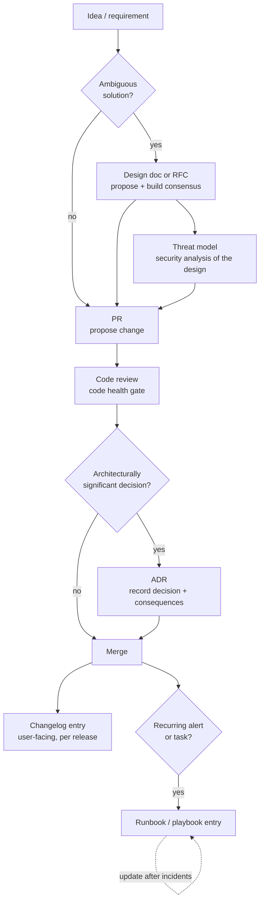

# What engineering documents a professional organisation maintains, and what each is for

> **Citation status (2026-10-18).** This is the cited version of the draft. Every substantive claim is
> attributed inline to a source that was actually retrieved during this run. URL reachability was checked
> two ways: (a) `fetch_content` retrieval, and (b) an automated HTTP status sweep
> (`outputs/.drafts/engineering-document-types-urlcheck.sh`, raw output in
> `outputs/.drafts/engineering-document-types-urlcheck.txt`). Result: 22 of the 24 cited primary URLs
> returned HTTP 200; `https://www.w3.org/TR/threat-modeling-guide/` returned 403 to `curl` due to bot
> protection but was retrieved successfully by `fetch_content` (113,018 chars); `https://doi.org/10.1109/ICSE.2019.00122`
> returned 202 (DOI resolver redirect). Four URLs used during research were dead and are **not** cited:
> gnu.org Change-Logs (connection failure), rfc-editor.org/rfc/rfc2026.html (extraction failure; plain-text
> version used), GitHub `about-pull-request-reviews` (404), Atlassian `incident-management/on-call/runbooks` (404).
> No independent agent verified the citation-to-claim mapping (direct-mode run).

**Scope:** the six artifact types named in the question — Architecture Decision Record (ADR),
design doc / RFC, runbook, threat model, changelog, pull-request description — plus a short note on
adjacent artifacts.
**Method:** direct primary-source research (official docs, standards, first-party handbooks, peer-reviewed
literature). No researcher subagents were used; see `outputs/.plans/engineering-document-types.md`.
**Evidence quality:** each artifact is anchored to a canonical or near-canonical source. Where the only
support is vendor content, expert opinion, or my own inference, that is labelled inline.

---

## Executive summary

1. **There is no single canonical list.** I found no standards body that publishes "the documents an
   engineering organisation maintains". The six artifacts in the question are a practitioner consensus that has to be
   reconstructed from separate primary sources, each of which defines one artifact. The unified framing
   below is a synthesis, not a quoted standard.
2. **The artifacts are distinguished by the question they answer, not by their file format.** A design doc
   and an RFC can look identical; what separates them is that an RFC is a consensus-seeking, archival record
   while a design doc is a working document that gets edited. An ADR and a design doc overlap heavily; what
   separates them is scope — one decision versus one design.
3. **Author's framing: three of the six are "why" artifacts, three are "what/how" artifacts.** ADR, design doc/RFC, and
   PR description exist to preserve reasoning that the code cannot express. Runbook, threat model, and
   changelog exist to make a specific action or change safe and legible. This split predicts the dominant
   failure mode of each group: "why" artifacts fail by not being written or by being written dishonestly;
   "what/how" artifacts fail by going stale.
4. **Staleness has the best empirical support of any failure mode found in this run.** A large ICSE 2019
   study of 878 documentation-related artifacts found that up-to-dateness issues accounted for 39% of
   documentation *content* problems, and completeness for 55% (Aghajani et al. 2019). That study covers
   software documentation broadly, not these six artifact types specifically — applying its percentages to
   ADRs, runbooks, or threat models is an extrapolation, not a finding (see §8).
5. **Terminology genuinely conflicts across organisations.** The strongest example: Google's SRE handbook
   calls an alert-response procedure a **playbook** and does not use the word "runbook" in that chapter,
   while PagerDuty defines a runbook as the small per-task procedure and a playbook as the larger
   orchestration. AWS and Azure use "runbook" to mean an executable automation script. "Runbook" is not a
   term with one agreed meaning.

---

## 1. The artifact map

The table is a synthesis across the sources cited in §2–§7. The "failure mode it prevents" column, and the
owner and cadence columns where a source does not state them, are my framing rather than quoted guidance.

| Artifact | Question it answers | Primary audience | Owner | Written when | Updated when | Failure mode it prevents |
|---|---|---|---|---|---|---|
| **ADR** | "Why is the architecture like this, and what did we give up?" | Future engineers, new joiners, reviewers | Whoever made the decision; architect | When an architecturally significant decision is made | Superseded, not edited | "Blindly accept" or "blindly change" a past decision |
| **Design doc / RFC** | "What are we proposing to build, and why this way?" | Peers, senior engineers, review forums | Primary author(s) | Before coding, when the solution is ambiguous | Design doc: edited through review; RFC: frozen after resolution | Building the wrong thing, or solving a known problem badly |
| **Runbook** | "What exactly do I do right now to fix this?" | On-call engineer under time pressure | Service team | When an alert/task is created or a failure recurs | After every relevant incident or system change | Improvisation, escalation, human error during incidents |
| **Threat model** | "What can go wrong security-wise, and what are we doing about it?" | Architects, security reviewers, implementers | Design owner + security | Early, at design time, before launch | On new feature, incident, or architecture change | Shipping a design with unexamined security properties |
| **Changelog** | "What changed between version X and Y, and will it break me?" | Users, integrators, contributors | Release manager / maintainers | Continuously, with an `Unreleased` section | Every release | Users upgrading blind into breaking changes |
| **PR description** | "What does this change do and why should it be merged?" | Reviewers, then future searchers of history | Change author | With the change | Before merge, to match what the review produced | Unreviewable changes and unrecoverable rationale |

Adjacent artifacts that a mature organisation typically also maintains, not covered in depth here:
postmortems (Google SRE, [postmortem culture](https://sre.google/sre-book/postmortem-culture/)),
README/CONTRIBUTING, API reference, architecture overview, and SLO/error-budget documentation.

### How they relate over a change's lifetime

---

## 2. Architecture Decision Record (ADR)

**Definition.** Michael Nygard's 2011 post is the origin of the practice: keep "a collection of records
for 'architecturally significant' decisions: those that affect the structure, non-functional
characteristics, dependencies, interfaces, or construction techniques"
([cognitect.com](https://cognitect.com/blog/2011/11/15/documenting-architecture-decisions)). The
adr.github.io community site generalises it: "An Architectural Decision Record (ADR) captures a single AD
and its rationale"; the set of ADRs in a project "constitute its *decision log*", and usage "can be
extended to design and other decisions ('any decision record')" ([adr.github.io](https://adr.github.io/)).

**Format and lifecycle.** Nygard specifies five parts — Title, Context, Decision, Status, Consequences —
kept to "one or two pages", stored in-repo (`doc/arch/adr-NNN.md`), "numbered sequentially and
monotonically", with numbers never reused. Crucially, ADRs are superseded rather than rewritten: "If a decision is
reversed, we will keep the old one around, but mark it as superseded." Status values are proposed,
accepted, deprecated, superseded.

**Purpose.** Nygard's stated motivation is the failure mode, not the format: without recorded rationale a
newcomer has only two options — "**Blindly accept the decision**" or "**Blindly change it**". Both are
harmful: accumulate too many unexplained decisions and "the development team becomes afraid to change
anything and the project collapses under its own weight".

**Boundary with design docs.** An ADR is deliberately narrow: "One ADR describes one significant decision
for a specific project." The consequences of one ADR "are very likely to become the context for subsequent
ADRs" — i.e. ADRs form a graph, whereas a design doc is one document about one design.

**Failure modes.** Olav Zimmermann catalogues eleven ADR anti-patterns, including *Fairy Tale* (wishful
thinking — "only pros but no cons", e.g. "We decided for a load balancer because it balances load, which is
a good thing"), *Sales Pitch* (marketing language), *Sprint/Rush* (only one option considered, only
short-term effects discussed), and *Blueprint or Policy in Disguise* (a cookbook or law-like tone)
([ozimmer.ch, 2023](https://www.ozimmer.ch/practices/2023/04/03/ADRCreation.html)). Zimmermann also warns
that "ADR logs should not turn into epics". This source is expert practitioner opinion, not peer-reviewed
evidence.

---

## 3. Design doc / RFC

These are two ends of one spectrum and are best explained together.

### 3a. Design doc — the internal working document

The most detailed public account of design docs at a large company is Malte Ubl's *Design Docs at Google*
(an engineer's blog post, not official Google documentation). It defines them as "relatively informal
documents that the primary author or authors of a software system or application create before they embark
on the coding project", documenting "the high level implementation strategy and key design decisions with
emphasis on the trade-offs that were considered"
([industrialempathy.com](https://www.industrialempathy.com/posts/design-docs-at-google/)).

Its stated functions are: early identification of design issues "when making changes is still cheap";
achieving consensus; ensuring cross-cutting concerns (security, privacy, observability) are considered;
scaling senior-engineer knowledge; forming "organizational memory around design decisions"; and serving as
a portfolio artifact.

**Anatomy:** context and scope, goals and non-goals, the actual design, alternatives considered, and
cross-cutting concerns. **Length:** "around 10-20ish pages" for a large project, with 1–3 page mini design
docs acceptable for incremental work. **Lifecycle:** creation and rapid iteration → review (possibly
multiple rounds) → implementation and iteration → maintenance and learning.

**Purpose.** The doc "is *the place to write down the trade-offs*". The strongest statement of purpose is
the negative one — when *not* to write a design doc: "If a doc basically says 'This is how we are going to
implement it' without going into trade-offs, alternatives, and explaining decision making ... then it would
probably have been a better idea to write the actual program right away." Writing docs is explicitly framed
as overhead to be justified by ambiguity of problem or solution.

### 3b. RFC — the consensus-seeking, archival proposal

Three independent RFC processes give a consistent picture.

- **IETF.** RFCs are "Requests for Comments" and are "the Internet's technical foundations"; the series
  "predates the IETF", began with RFC 1 in 1969, and now exceeds 9,000 documents. Statuses include
  Informational, Experimental, Proposed Standard, Internet Standard, Best Current Practice, and Historic.
  Only the IETF Stream can publish standards, and all such RFCs "must have community rough consensus".
  Critically: "once an RFC is published, it is never changed, which is why the RFC series is often described
  as 'archival'". Errors are handled by errata, and RFCs are superseded or updated by *other* RFCs
  ([ietf.org/process/rfcs](https://www.ietf.org/process/rfcs/); the process itself is specified in
  [RFC 2026](https://www.rfc-editor.org/rfc/rfc2026.txt), which defines the Standards Track maturity levels
  and non-standards-track levels).
- **Rust.** "The 'RFC' (request for comments) process is intended to provide a consistent and controlled
  path for changes to Rust (such as new features) so that all stakeholders can be confident about the
  direction of the project." RFCs are required only for "substantial" changes; a merged RFC becomes
  "active" and may then be implemented. The process includes sub-team triage and a "motion for final comment
  period" with a disposition of merge, close, or postpone
  ([rust-lang/rfcs README](https://github.com/rust-lang/rfcs)).
- **Python (PEP).** "A PEP is a design document providing information to the Python community, or
  describing a new feature for Python or its processes or environment. The PEP should provide a concise
  technical specification of the feature and a rationale for the feature." Types: Standards Track,
  Informational, Process. Once resolved, "a PEP is considered a historical document rather than a living
  specification. Formal documentation of the expected behavior should be maintained elsewhere"
  ([PEP 1](https://peps.python.org/pep-0001/)).

**The design-doc/RFC boundary.** The decisive difference is *archival versus living*. Design docs are
maintained and edited ("Maintenance and learning" is an explicit lifecycle phase); RFCs and PEPs are
frozen at resolution and superseded rather than revised. A second difference is *audience and authority*:
design docs build consensus inside one organisation, whereas RFCs build rough consensus across an external
community and carry normative status (Internet Standard, BCP).

---

## 4. Runbook

**Definition (the "human procedure" sense).** PagerDuty: "A runbook is a detailed 'how-to' guide for
completing a commonly repeated task or procedure within a company's IT operations process." It is created
so that "everyone on the team—new or experienced" can "quickly and accurately resolve a given issue".
PagerDuty distinguishes three implementations — manual, semi-automated, and fully-automated — and insists
runbooks must be "constantly updated to ensure it is the most effective solution"
([pagerduty.com](https://www.pagerduty.com/resources/learn/what-is-a-runbook/); this is vendor content, so
treat the specifics as marketing-adjacent).

**Definition (the large-company SRE sense).** Google's SRE Workbook, in its on-call chapter, uses the word
**playbook**, not runbook: "Playbooks contain high-level instructions on how to respond to automated
alerts. They explain the severity and impact of the alert, and include debugging suggestions and possible
actions to take to mitigate impact and fully resolve the alert. In SRE, whenever an alert is created, a
corresponding playbook entry is usually created. These guides reduce stress, the mean time to repair
(MTTR), and the risk of human error"
([sre.google/workbook/on-call](https://sre.google/workbook/on-call/)). The same chapter states the
maintenance rule directly: "Make sure playbooks are up to date ... On-call engineers should update the
playbook with fresh information when the corresponding page fires," and "Each alert should have a
corresponding playbook entry." **A text search of that chapter's extracted content returned no match for
"runbook"** (findText check over the fetched page, 2026-10-18) — this is a real terminology conflict, not a
formatting detail.

**Definition (the "automation" sense).** Both major clouds use "runbook" to mean executable code:

- AWS Systems Manager: "An Automation runbook defines the *actions* that Systems Manager performs on your
  managed instances and other AWS resources when an automation runs ... A runbook contains one or more steps
  that run in sequential order." Runbooks are authored in YAML or JSON
  ([AWS docs](https://docs.aws.amazon.com/systems-manager/latest/userguide/automation-documents.html)).
- Azure Automation: runbook types are PowerShell, PowerShell Workflow, Python, and Graphical — i.e.
  scripts, not prose ([Microsoft Learn](https://learn.microsoft.com/en-us/azure/automation/automation-runbook-types)).

**Purpose.** Collapsing the senses, a runbook encodes the *team's best known procedure* so that responding
does not depend on who is on call or on tribal memory. PagerDuty's framing is the clearest: without it,
solving an issue "could mean a quick Google search, looking through the company wiki ... asking a coworker,
or escalating" — and may result in "a solution that may or may not be the company's best practice".

**Runbook vs playbook.** PagerDuty: "if a runbook is a recipe, then the playbook would be the guidebook for
hosting a given social event" — a playbook is the overarching response that "can include multiple runbooks
and team members". Note this is the *opposite* polarity from Google, where the playbook is the per-alert
procedure. Anyone adopting these terms across organisations should expect to define them locally.

---

## 5. Threat model

**Definition.** OWASP: "Threat modeling works to identify, communicate, and understand threats and
mitigations within the context of protecting something of value. A threat model is a structured
representation of all the information that affects the security of an application." A threat model
typically contains a description of the subject, assumptions that "can be checked or challenged in the
future as the threat landscape changes", potential threats, mitigations for each, and "a way of validating
the model and threats"
([owasp.org](https://owasp.org/www-community/Threat_Modeling)).

The W3C Threat Modeling Guide gives the tightest formal definition: "threat model — The artifact produced
by threat modeling. A threat model describes the system under analysis, scope, stakeholders, threats,
assumptions, impacts, harms, and responses." It adds that a useful model records the system under analysis
(actors, components, flows, trust boundaries), the scope "with rationale for anything explicitly deemed out
of scope", stakeholders and assets, the important threats and harms, the selected responses, and any
remaining threats. Scope matters normatively here: "Scoping decisions are not responses" — marking something
out of scope "does not, by itself, address a threat"
([w3.org/TR/threat-modeling-guide](https://www.w3.org/TR/threat-modeling-guide/)).

**Purpose and timing.** Microsoft places threat modeling inside the Security Development Lifecycle: the
tool "allows software architects to identify and mitigate potential security issues early, when they are
relatively easy and cost-effective to resolve", and the SDL approach "is a focused design analysis
technique" using STRIDE per element
([Microsoft Learn](https://learn.microsoft.com/en-us/azure/security/develop/threat-modeling-tool)).
OWASP likewise frames it as a design-time activity refined across the lifecycle, with updates advised
"after events such as: A new feature is released; Security incident occurs; Architectural or infrastructure
changes". The W3C guide goes further and prescribes where the artifact sits in a standard's lifecycle —
charter, explainer, working draft, and before Candidate Recommendation, where it becomes the thing
horizontal reviewers read instead of reconstructing the analysis themselves.

**What it is for, in the practitioners' own words.** The Threat Modeling Manifesto (2020; 15 named authors
including Adam Shostack, Zoe Braiterman and Irene Michlin) states the purpose as a value pair: "A culture of
finding and fixing design issues over checkbox compliance." It also makes the document's role explicit:
"Dialog is key to establishing the common understandings that lead to value, while documents record those
understandings, and enable measurement." Its four questions are: What are we working on? What can go wrong?
What are we going to do about it? Did we do a good enough job?
([threatmodelingmanifesto.org](https://www.threatmodelingmanifesto.org/)).

**Disclosure.** Shostack et al. (2025) argue for making threat models public: internal threat models "may
not be directly suitable for disclosure so we provide guidance for redaction and review, as well as when to
update models". The paper is accepted at the ACM HealthSec workshop
([arXiv:2511.08295](https://arxiv.org/abs/2511.08295)).

**Failure modes.** The Manifesto's named anti-patterns include treating threat modeling as dependent on
"one's innate ability or unique mindset" (it is not), stopping at analysis without "practical and relevant
solutions", and "exaggerating attention on adversaries, assets, or techniques" at the expense of the whole
picture. OWASP's framing of the alternative — the assurance argument — is the positive counterpart: "the
threat modeling process naturally produces an assurance argument that can be used to explain and defend the
security of an application."

---

## 6. Changelog

**Definition.** Keep a Changelog (Olivier Lacan, an opinionated community convention, self-described as
"not the **truth**; it's my carefully considered opinion"): "A changelog is a file which contains a
curated, chronologically ordered list of notable changes for each version of a project"
([keepachangelog.com](https://keepachangelog.com/en/1.1.0/)).

**Purpose and audience.** "To make it easier for users and contributors to see precisely what notable
changes have been made between each release (or version) of the project." Audience: "People do. Whether
consumers or developers, the end users of software are human beings who care about what's in the software."

**Format.** Guiding principles: changelogs are for humans, not machines; an entry for every version; group
the same types of changes; make versions and sections linkable; latest version first; display release
dates; state whether Semantic Versioning is followed. Change types: `Added`, `Changed`, `Deprecated`,
`Removed`, `Fixed`, `Security`. A maintained `Unreleased` section at the top reduces the effort of writing
release notes.

**The changelog/commit-log/PR boundary.** Keep a Changelog is explicit that a commit log is not a changelog:
"Using commit log diffs as changelogs is a bad idea: they're full of noise. Things like merge commits,
commits with obscure titles, documentation changes, etc." The reason is a difference of purpose: "The
purpose of a commit is to document a step in the evolution of the source code ... The purpose of a changelog
entry is to document the noteworthy difference, often across multiple commits, to communicate them clearly
to end users." So the changelog is the *release-scoped, user-facing* record; the commit log is the
*change-scoped, mechanical* record; the PR description (§7) is the *change-scoped, reasoned* record.

**Failure modes.** Named bad practices: commit-log diffs as changelogs; ignoring deprecations ("If you do
nothing else, list deprecations, removals, and any breaking changes"); ambiguous date formats (ISO 8601
recommended); and inconsistency — "A changelog which only mentions some of the changes can be as dangerous
as not having a changelog ... By inconsistently applying changes, your users may mistakenly think that the
changelog is the single source of truth. It ought to be."

**Caveat.** Keep a Changelog states there is no real standard, and characterises the GNU changelog style
guide and GNU NEWS file as "inadequate or insufficient". I could not retrieve the GNU page during this run
(fetch failed), so that characterisation is reported second-hand from Keep a Changelog rather than verified
against GNU's own text.

---

## 7. Pull-request description

**Definition.** GitHub: "Pull requests are proposals to merge code changes into a project. A pull request
is GitHub's key **collaboration feature**, letting you discuss and review changes before merging them. This
helps teams work together, catch issues early, and maintain code quality." The description lives in the
**Conversation** tab alongside the timeline, comments, and reviews; the other tabs are Commits, Checks,
Files changed, and Findings
([GitHub docs](https://docs.github.com/en/pull-requests/collaborating-with-pull-requests/proposing-changes-to-your-work-with-pull-requests/about-pull-requests)).

**Purpose.** The clearest normative statement of what the description is for comes from Google's engineering
practices, where the equivalent artifact is the changelist (CL) description: "A CL description is a public
record of change", and it must communicate (1) **what** is changing, so readers "have a sense of what is
being changed without needing to read the entire CL", and (2) **why**, including "contexts did you have as
an author when making this change" and "decisions you made that aren't reflected in the source code"
([google.github.io/eng-practices](https://google.github.io/eng-practices/review/developer/cl-descriptions.html)).

The durability claim is the reason to care: "The CL description will become a permanent part of our version
control history and will possibly be read by hundreds of people over the years." Future developers search
for changes *by description*, and source code "may reveal what the software is doing but it may not reveal
why it exists", which is what makes it hard to know whether a piece of code is a Chesterton's fence.

**Format.** A first line that is "a short summary of *specifically* what is being done by the CL", as a
complete imperative sentence, followed by a blank line; then an informative body that may include bug
numbers, benchmark results, and links to design documents. The guidance warns that external links "may not
be visible to future readers due to access restrictions or retention policies".

**What the PR is *for* beyond the description.** Google's code-review standard states the gate's purpose:
"The primary purpose of code review is to make sure that the overall code health of Google's code base is
improving over time." The bar is deliberately not perfection: "there is no such thing as 'perfect' code—
there is only *better* code", and reviewers should approve once a change "definitely improves the overall
code health ... even if the CL isn't perfect". It also names mentoring and conflict resolution, with the
instruction to record a resolved disagreement "as a comment on the CL, for future readers"
([google.github.io/eng-practices](https://google.github.io/eng-practices/review/reviewer/standard.html)).

**Failure modes.** Google lists real, rejected examples of bad descriptions: "Fix bug", "Fix build",
"Add patch", "Moving code from A to B", "Phase 1", "Add convenience functions", "kill weird URLs". Their
common defect is that they omit the *why* and cannot be searched.

**Boundary note (inference).** Google's model conflates the CL description with the eventual commit
message — that is why it is "a permanent part of our version control history". In a GitHub-style
fork-and-pull workflow, the PR description is a conversation artifact and is not necessarily carried into
the repository's git history at merge time. If that inference holds, then organisations on GitHub-style
flows get durable rationale only if they separately preserve it (squash-merge commit body, ADR, or
changelog). I did not find a primary source that states this directly; treat it as an inference to verify.

---

## 8. Empirical evidence on documentation quality

The strongest empirical anchor found is Aghajani et al., *Software Documentation Issues Unveiled*
(ICSE 2019, pp. 1199–1210, DOI [10.1109/ICSE.2019.00122](https://doi.org/10.1109/ICSE.2019.00122)). The
authors mined, analysed, and categorised documentation-related artifacts from four sources — mailing lists,
Stack Overflow discussions, issue repositories, and pull requests — specifically to avoid the bias of
survey-only studies. Verified figures from the author preprint:

| Measure | Value |
|---|---|
| Documentation-related artifacts mined | 878 |
| Artifacts retained after conflict resolution | 824 |
| Labelled sentences | 1,548 |
| Documentation issue types identified | 162, in four main categories |
| Content ("what") artifacts | 485 — Correctness 72, Completeness 268, Up-to-dateness 190 |
| Presentation ("how") artifacts | 255 — Usability 138, Maintainability 21, Readability 107, Usefulness 20 |
| Tool-related artifacts | 134 — Bug 17, Support/Expectations 34, Help required 90, Tool migration 4 |
| Process-related artifacts | 81 — Internationalization 20, Traceability 5, Dev issues caused by docs 8, Contributing 50, Doc-generator config 4 |

Reported shares: Completeness "accounts for 55% of the issues related to the documentation content";
Up-to-dateness "account for 39%"; within up-to-dateness, "in 21% of these cases, the inconsistency appeared
to be between a system's behavior and its description in the documentation". Within usability, "half of the
issues (50%) were related to information findability"; within readability, "lack of clarity represented
more than half (55%)". Source distribution differs by category — content issues are mostly discussed in
issues (46%) and pull requests (42%), process issues mostly in mailing lists (40%), tool issues mostly on
Stack Overflow (61%).

Source: author preprint, [csnagy.github.io/.../Aghajani2019-preprint.pdf](https://csnagy.github.io/research/pdfs/2019/Aghajani2019-preprint.pdf);
metadata via [OpenAlex W2955439455](https://openalex.org/W2955439455) (194 citing works as of 2026-10-18).

Their conclusion, quoted: "Developers (and users) prefer documentation that is correct, complete, up to
date, usable, maintainable, readable and useful."

**How to read this evidence.** Two limits matter. First, it studies *software documentation* broadly
(API references, code comments, installation guides, user manuals) — it is not a study of ADRs, runbooks,
or threat models specifically, so applying its percentages to those artifacts is an extrapolation, not a
finding. Second, the paper reports its own threats to validity, including that the taxonomy "depends on the
particular set of discussions we analyzed". A second, smaller anchor is Rost et al., *Software Architecture
Documentation for Developers: A Survey* (2013, DOI [10.1007/978-3-642-39031-9_7](https://doi.org/10.1007/978-3-642-39031-9_7),
32 citing works); I retrieved only its metadata, so I make no claim about its findings.

---

## 9. Disagreements, gaps, and things I could not verify

**Genuine disagreements between sources**

1. **Runbook vs playbook polarity.** PagerDuty: playbook is the larger orchestration containing runbooks.
   Google SRE: the playbook is the per-alert procedure, and "runbook" is not used. AWS/Azure: "runbook" is
   an executable automation script. There is no reconcilable single definition.
2. **Whether the description or the commit message is the durable rationale.** Google treats the CL
   description as the permanent history record; Keep a Changelog treats the commit log as noise and the
   changelog as the user-facing record; GitHub treats the PR description as a conversation. The three
   positions imply different answers to "where does the 'why' live?".
3. **How prescriptive a design artifact should be.** Ubl argues design docs are informal and that a doc
   which is really an implementation manual should not have been written; the RFC tradition is the opposite
   — a merged RFC is normative and implementation may not begin until it is accepted.
4. **Threat model as document vs as activity.** The Manifesto privileges "doing threat modeling over
   talking about it" and treats documents as records of a dialogue; W3C treats the threat model as a
   reviewable artifact with a prescribed place in a standard's lifecycle. These are compatible but shift
   the emphasis from process to artifact.

**Gaps**

- No source found that gives an authoritative *complete list* of an engineering organisation's documents;
  the taxonomy in §1 is my synthesis.
- The GNU changelog standard could not be retrieved, so its alleged inadequacy is unverified.
- No evidence found on the *cost* of maintaining these artifacts, or on how many organisations actually
  maintain each one. Any claim of the form "most teams do X" would be unsupported here.
- Postmortems, READMEs, API references, and SLO docs are named but not analysed.

**Open questions**

1. Does the PR description's rationale survive into git history in squash-merge workflows, and if not, do
   organisations compensate with a separate decision record? (§7 inference — untested.)
2. What is the actual, measured relationship between maintaining these artifacts and delivery outcomes
   (incident MTTR, defect escape rate, onboarding time)? The Aghajani study measures documentation *issues*,
   not the *value* of each artifact type.
3. Is there any empirical study specifically of ADR, runbook, or threat-model practice (as opposed to
   software documentation generally)? Searches did not surface one; this may be a genuine gap in the
   literature.
4. How do organisations handle the ADR/design-doc overlap in practice — do they maintain both, or merge
   them?

---

## Sources

All URLs below were retrieved successfully during this run on 2026-10-18 unless marked otherwise. Reachability
was verified with an automated HTTP status sweep (`outputs/.drafts/engineering-document-types-urlcheck.txt`).

1. Michael Nygard, *Documenting Architecture Decisions*, 2011 — https://cognitect.com/blog/2011/11/15/documenting-architecture-decisions
2. adr.github.io community site, *Architectural Decision Records (ADRs)* — https://adr.github.io/
3. Olav Zimmermann, *How to create Architectural Decision Records (ADRs) — and how not to*, 2023 — https://www.ozimmer.ch/practices/2023/04/03/ADRCreation.html (expert opinion)
4. Malte Ubl, *Design Docs at Google* — https://www.industrialempathy.com/posts/design-docs-at-google/ (personal blog)
5. IETF, *About RFCs* — https://www.ietf.org/process/rfcs/
6. B. Bradner, *The Internet Standards Process — Revision 3*, RFC 2026, 1996 — https://www.rfc-editor.org/rfc/rfc2026.txt
7. Rust RFC process — https://github.com/rust-lang/rfcs
8. B. Warsaw et al., *PEP 1 – PEP Purpose and Guidelines* — https://peps.python.org/pep-0001/
9. PagerDuty, *What is a Runbook?* — https://www.pagerduty.com/resources/learn/what-is-a-runbook/ (vendor content)
10. Google SRE Workbook, *On-Call* — https://sre.google/workbook/on-call/
11. AWS, *Creating your own runbooks* (Systems Manager Automation) — https://docs.aws.amazon.com/systems-manager/latest/userguide/automation-documents.html
12. Microsoft, *Azure Automation Runbook Types* — https://learn.microsoft.com/en-us/azure/automation/automation-runbook-types
13. OWASP, *Threat Modeling* — https://owasp.org/www-community/Threat_Modeling
14. Threat Modeling Manifesto, 2020 — https://www.threatmodelingmanifesto.org/
15. Microsoft, *Threat Modeling Tool overview* — https://learn.microsoft.com/en-us/azure/security/develop/threat-modeling-tool
16. W3C, *Threat Modeling Guide* — https://www.w3.org/TR/threat-modeling-guide/
17. A. Shostack et al., *Publish Your Threat Models!*, 2025, arXiv:2511.08295 — https://arxiv.org/abs/2511.08295
18. Olivier Lacan, *Keep a Changelog* v1.1.0 — https://keepachangelog.com/en/1.1.0/
19. GitHub Docs, *Pull requests* — https://docs.github.com/en/pull-requests/collaborating-with-pull-requests/proposing-changes-to-your-work-with-pull-requests/about-pull-requests
20. Google, *Writing good CL descriptions* — https://google.github.io/eng-practices/review/developer/cl-descriptions.html
21. Google, *The Standard of Code Review* — https://google.github.io/eng-practices/review/reviewer/standard.html
22. E. Aghajani et al., *Software Documentation Issues Unveiled*, ICSE 2019 — preprint https://csnagy.github.io/research/pdfs/2019/Aghajani2019-preprint.pdf ; DOI https://doi.org/10.1109/ICSE.2019.00122 ; metadata https://openalex.org/W2955439455
23. D. Rost et al., *Software Architecture Documentation for Developers: A Survey*, 2013 — https://openalex.org/W1503924010 (metadata only)
24. Google SRE Book, *Postmortem Culture* (adjacent artifact) — https://sre.google/sre-book/postmortem-culture/
