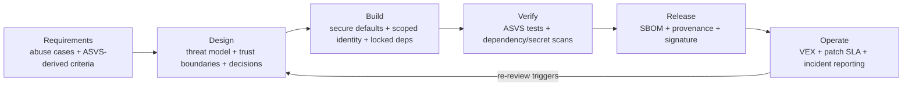

# Security by Design in Practice

### Threat modelling, OWASP ASVS/SAMM, least privilege, secrets, dependency hygiene, and SBOM — what the evidence actually supports

**Date:** 19 October 2026
**Scope:** Engineering practice and standards as of October 2026. Prescribed practice (what standards require) is separated from observed practice and outcome evidence (what studies and incidents show).

---

## Executive summary

1. **"Security by design" is not one activity.** In current official usage it means making security a property of the product and its delivery system before release, rather than a test performed afterward. CISA frames it as producer accountability and secure defaults [1][2]; NIST's SSDF frames it as secure practices integrated throughout the lifecycle [4]; the EU Cyber Resilience Act makes parts of it a legal obligation for products sold in the EU [15][18].
2. **The named instruments do different jobs and are not substitutes.** Threat modelling is design-time reasoning; OWASP ASVS is a set of verifiable product requirements; OWASP SAMM is a program-maturity and improvement model; least privilege and secrets management are identity/credential architecture; dependency hygiene and SBOM are supply-chain inventory and provenance. A program that buys one and calls it "security by design" has bought a document, not a capability.
3. **Prescribed practice is mature; outcome evidence is thin.** Threat-modelling research measures how many threats methods surface and at what cost, not whether breaches fall [27][28][29]. SBOM research finds accuracy and tooling gaps, not breach reduction [78][79][80]. SAMM is a self-assessment model [10][11]. These are useful instruments, but their adoption is not itself evidence of security.
4. **The strongest documented failure modes are mundane and architectural:** forgotten non-production identities with excessive permissions, long-lived shared secrets in CI, CI environment variables exfiltrated en masse, over-broad service accounts, and dependencies that execute code at install time [48][49][50][51][71][88]. These are design and lifecycle failures, not detection failures.
5. **Regulation has moved from encouragement to obligation.** The CRA's reporting duties have applied since 11 September 2026; its main obligations apply from 11 December 2027 [15][16]. It requires vulnerability handling and an SBOM for products with digital elements [18]. In the US, the 2022 attestation memorandum was rescinded in January 2026 and SBOM became a contractual option rather than a government-wide mandate [82]. "SBOM is required" is therefore jurisdiction-dependent.
6. **A defensible minimum program is small and artifact-based:** a threat model per significant change, ASVS-derived acceptance criteria, short-lived workload credentials, a central secret store with revocation rehearsed, lockfiles plus dependency review, an SBOM generated at build, and provenance/signature verification at deploy. Each artifact must change a decision or block a release; otherwise it is compliance theater.
7. **The first 90 days should prioritize identity and dependencies before maturity scoring.** Over-privileged identities and leaked credentials have immediate blast radius; dependency compromise is a recurring, documented attack class [69][71][87]; ASVS L1 requirements and a lightweight threat-model workflow are cheaper to start than a full SAMM assessment.

---

## 1. What "security by design" means in practice

### 1.1 The official definitions converge on outcomes, not methods

CISA's Secure by Design guidance says products "prioritize the security of customers as a core business requirement, rather than merely treating it as a technical feature," and that companies should implement the principles "during the design phase ... to significantly decrease the number of exploitable flaws before introducing them to the market" [1]. Its three principles are **take ownership of customer security outcomes**, **embrace radical transparency and accountability**, and **lead from the top** [2]. The companion pledge is voluntary and explicitly not legally binding [3].

NIST SP 800-218 (SSDF v1.1, February 2022) defines a core set of high-level practices that can be integrated into any SDLC, organized into four groups: **Prepare the Organization (PO)**, **Protect the Software (PS)**, **Produce Well-Secured Software (PW)**, and **Respond to Vulnerabilities (RV)** [4]. NIST describes the SSDF practices as a high-level subset of what organizations may need to do [4].

The CRA requires mandatory cybersecurity requirements covering the planning, design, development, production, delivery and maintenance phases of products, plus vulnerability handling across the lifecycle [15][17]. Its obligations are outcome-oriented; it does not mandate ASVS, SAMM, or SSDF by name.

OWASP ASVS is deliberately narrower: it "does not prescribe development lifecycle activities or dictate how the application should be built via a CI/CD pipeline; instead, it specifies the security outcomes that must be achieved within the product itself" [7]. That sentence is the cleanest available statement of ASVS's boundary — and a warning against treating an ASVS checklist as a complete security-by-design program.

### 1.2 A workable definition

For engineering purposes, security by design is:

> The set of design, identity, dependency, and delivery decisions that (a) remove or constrain classes of attack before code ships, (b) make the secure behavior the default behavior, and (c) leave evidence that the decision was made and is still true.

This definition has three consequences:

- **It is about decisions, not documents.** A threat model that no one reads and an SBOM no one queries are artifacts without decisions behind them.
- **Defaults matter more than features.** CISA's secure-by-default framing — security features available at no extra cost, controls enabled out of the box, mechanisms that protect customers rather than enlarge attack surface [2] — is an operational test: what does a customer get if they change nothing?
- **Evidence must be re-checked.** Threat models, IAM policies, dependencies, and SBOMs all decay. A design decision is only "by design" while the system still matches it.

### 1.3 Security by design is not the same as secure by default, shift left, or compliance

| Term | What it asserts | What it does not assert |
|---|---|---|
| Security by design | Security-relevant decisions are made during design and embodied in the product and pipeline | That every flaw is found, or that the product is secure |
| Secure by default | The no-configuration state is the safe state | That configurability cannot weaken it |
| Shift left | Security work happens earlier, where defects are cheaper | That early work is sufficient or correctly prioritized |
| Compliance | A defined control set or artifact exists | That the control is effective, current, or covers this system's threats |

The CRA, ASVS, SAMM, and SSDF each measure a different slice of this space. None of them, alone, establishes that a system is secure.

---

## 2. The operating model: artifacts that connect the practices

Security by design becomes real when each lifecycle stage produces an artifact that another stage consumes and checks. The following is a synthesis of the standards above, not a quotation from any one of them.

| Stage | Primary artifact | Decision it forces | Evidence it leaves |
|---|---|---|---|
| Requirements | Abuse/misuse cases; ASVS requirements scoped to the system | Which threats and security outcomes are in scope | Acceptance criteria with requirement IDs |
| Design | One-page data-flow diagram with trust boundaries; threat table | Mitigate / eliminate / transfer / accept, with owner | Threat model in version control; issues with due dates |
| Build | Secure defaults; scoped roles; lockfiles; secret references not values | Who/what can act, and with what | IAM policy diffs; lockfile; secret-scan results |
| Verify | ASVS-derived tests; dependency review; SAST/DAST where useful | Does the artifact meet the stated criteria? | Test evidence mapped to requirement IDs |
| Release | SBOM; SLSA provenance; signature | What is in the artifact and how was it built? | Signed SBOM/provenance stored with the release |
| Operate | VEX statements; patch SLA; incident report | Is this vulnerability exploitable here, and by when must it be fixed? | VEX records; remediation times; CRA reports if in scope |

The table is intentionally tool-agnostic. The failure mode is not "wrong tool"; it is an artifact with no consumer and no decision. A threat model that does not create issues, an SBOM that is never queried, and an access review that removes no permissions are all the same failure.

---

## 3. Threat modelling: design-time reasoning

### 3.1 What it is

The Threat Modeling Manifesto defines threat modelling as "analyzing representations of a system to highlight concerns about security and privacy characteristics" [20]. The widely used operational frame is Shostack's four questions: **What are we working on? What can go wrong? What are we going to do about it? Did we do a good job?** [21]. OWASP's cheat sheet adopts the same structure and adds method selection, cloud-specific guidance, and maintenance advice [22].

### 3.2 The methods in use

| Method | Artifact | Best fit | Cost / caveat |
|---|---|---|---|
| **STRIDE** (Kohnfelder & Garg, Microsoft, 1999) [24] | Threats mapped to data-flow-diagram elements, with mitigations | Technical design of a component or service | Low to learn; output varies significantly by analyst [23][95] |
| **LINDDUN** (KU Leuven, 2010) | Privacy threat trees from a DFD | Systems processing personal data | More specialized; lean and in-depth variants [98] |
| **PASTA** (2012) | Business-framed risk register across seven stages | Risk-driven organizations with decision-makers available | High effort; requires business context [23] |
| **Attack trees** (Schneier, 1999) | Goal at root, alternative/required paths at leaves | A high-value objective with a clear attacker goal | Narrow by design; one experiment found them more effective than misuse cases for threat finding [96] |
| **Abuse / misuse cases** (Sindre & Opdahl, 2000) | Hostile-actor scenarios that double as requirements | Requirements work; integrating security into user stories | Low cost; less systematic for architecture-level threats [23] |
| **OCTAVE** (CERT/SEI) | Organizational risk assessment | Enterprise-level risk, not a single feature | High cost |

SEI's 2018 comparison covers twelve methods and explicitly declines to recommend one over another; selection depends on scope, time, experience, and stakeholders [23]. That is a useful corrective to tool marketing: there is no evidence-ranked "best" method, only a fit to context.

### 3.3 A credible workflow for a product team

1. **Scope to a change, not the whole product.** Shostack's framing is "what are we working on *right now*," which avoids re-litigating already-built scope [21].
2. **Draw or update a data-flow diagram** with processes, data stores, external entities, and trust boundaries. Keep it next to the code [22].
3. **Enumerate threats with prompts.** STRIDE for technical design; LINDDUN if personal data is involved; attack trees for a high-value goal; misuse cases for workflow abuse [22][23].
4. **Decide a response per threat** — mitigate, eliminate, transfer, or accept — with an owner, rationale, and a backlog issue [22].
5. **Re-review on triggers**, not a calendar: architecture change, new cloud service or trust boundary, new data class, new regulation, or a material incident [22][31].

Observed practice at scale supports this shape. GitLab uses an "evidence-driven PASTA" process in which the security team owns the framework but developers run it from a markdown template; outputs become issues with directly responsible individuals and due dates [31]. Google distinguishes proactive modelling of systems being designed from retrospective modelling, and concedes it can only do a finite number per year [32]. Both are consistent with the same lesson: threat modelling scales as a developer-owned, reviewable artifact, not as a central security team's workshop service.

### 3.4 What the evidence shows — and does not

The evidence is strongest on method mechanics and weakest on security outcomes.

- **A systematic literature review** by Xiong and Lagerström assessed 176 articles and selected 54, clustering work into method contributions, method use, and process introductions [27].
- **Controlled experiments disagree.** A 2018 comparison of STRIDE-per-element and per-interaction measured a significant difference in recall; a 2022 replication with 45 student participants found productivity and precision "not significantly different" and did not analyse recall, so the 2018 result was not reproduced [28][93].
- **Output varies by analyst, not just method.** SEI material reports "great variability" across teams using STRIDE, and Security Cards finding the most threat types but also with substantial variability [95]. Note: the source is a DTIC-hosted presentation that blocked automated retrieval during this run [95]; treat the variability claim as single-source and directional.
- **Practitioner studies find skill and process barriers.** A USENIX Security 2025 interview study of 25 open-source developers found ad hoc threat-finding and an expertise gap that led some to doubt the benefit [30]. Yskout et al. argued in 2020 that threat modelling was still at a low level of maturity [29].
- **No located peer-reviewed study** demonstrates that threat modelling reduces real incidents or breaches. Microsoft's SDL claims are vendor assertions [25].

**Inference:** threat modelling is best justified as a decision-forcing and communication mechanism, not as a proven risk-reduction intervention. That is still valuable — it surfaces design assumptions and creates owned mitigations — but it should not be sold with outcome numbers that do not exist.

### 3.5 Failure modes

- **The hero modeller.** A single expert becomes the bottleneck; the Manifesto names this anti-pattern and argues for organization-wide capability [97].
- **The stale model.** A diagram that is not maintained alongside the system becomes fiction; OWASP says a threat model should be maintained, updated, and refined with the system [22].
- **Checklist theatre.** OWASP explicitly warns against adding techniques only to make the model appear comprehensive [22].
- **Missing deployment context.** STRIDE and DFDs often need adaptation for cloud shared-responsibility models, managed services, multi-tenancy, and dynamic infrastructure [22].
- **No owner for mitigations.** A threat table without issues, owners, and dates is a brainstorm, not a control.

### 3.6 Minimum viable practice

For a small team: one 60–90 minute design review per significant feature; a one-page DFD with trust boundaries committed to the repository; STRIDE prompts for technical design and LINDDUN prompts if personal data is involved; a threat table with a decision and owner per row; re-review on architecture/cloud/data/regulation triggers [22][23]. Free tooling exists (OWASP Threat Dragon, pytm, Threagile) and "threat model as code" addresses staleness by keeping the model in version control and CI [34][35][36]. Microsoft's five-step SDL process and Threat Modeling Tool also remain published [26]. No controlled study of those tools' efficacy was located; the benefit is traceability, not proven threat coverage.

---

## 4. OWASP ASVS and SAMM: requirements versus program maturity

### 4.1 ASVS: verifiable product requirements

**Current version:** ASVS **5.0.0**, released **30 May 2025** [5][6]. It contains roughly **345 requirements across 17 chapters**, organized into three priority-based levels [7][8][99].

| Level | Size in 5.0.0 | Intended use |
|---|---|---|
| L1 | 70 requirements (~20%) | First-layer defenses; lowest barrier to entry |
| L2 | ~50% of requirements; compliance requires all L1 + L2 (~70% of the standard) | "Most applications should be striving to achieve this level" |
| L3 | final ~30% | Defense-in-depth and harder controls; high-assurance applications |

Source: ASVS 5.0 "What is the ASVS" [7]. The percentages are ASVS's own characterization. The OWASP Top 10:2025 provides the awareness-level counterpart to ASVS: A03 is Software Supply Chain Failures and A06 is Insecure Design [14].

**What changed in 5.0 matters for practice:**

- Requirements are centered on **security goals**, not specific mechanisms; mechanisms appear only where they are the sole practical solution [8].
- **Documented security decisions** became explicit requirements: for some controls the organization must document its chosen approach (for example, permissions, input validation, allowed file types), separately from implementing it, so documentation and implementation can be verified independently [7].
- Direct CWE and NIST SP 800-63 mappings were removed; a mapping via OWASP's planned Common Requirement Enumeration is intended [8].
- Of 286 v4.0.3 requirements, only 11 are unchanged; 109 no longer exist as separate requirements (50 deleted, 28 deduplicated, 31 merged) [8]. **A v4 compliance claim does not carry over unchanged.**

**How to use it without boiling the ocean:**

1. Choose a target level based on risk and user expectations. ASVS deliberately does not prescribe a level by application type; its own examples range from an early-stage startup focusing on L1 to a bank needing L3 [7].
2. Scope chapters to the system (drop WebRTC, OAuth/OIDC, or frontend chapters that do not apply) and create an organization-specific fork if needed; ASVS encourages this while requiring traceable requirement IDs [7].
3. Express requirements as acceptance criteria and tests, using versioned IDs such as `v5.0.0-1.2.5` [7].
4. Treat the documentation requirements as design artifacts, not paperwork: they are where the organization records decisions that cannot be standardized across applications [7].

**What ASVS cannot do:** it does not cover CI/CD, hosting, operational processes, or the development lifecycle [7]. It is a product-requirements standard, so it cannot by itself make a pipeline secure. It also cannot tell you whether the requirement is implemented correctly in your architecture — that is the verification activity.

### 4.2 SAMM: program maturity and improvement

**Current version:** OWASP SAMM **2.0**, released **3 February 2020** [13]. The model has **5 business functions × 3 security practices = 15 practices**, each with two streams and **three maturity levels** [9][10][11].

| Business function | Practices |
|---|---|
| Governance | Strategy and Metrics; Policy and Compliance; Education and Guidance |
| Design | **Threat Assessment; Security Requirements; Secure Architecture** |
| Implementation | Secure Build; Secure Deployment; Defect Management |
| Verification | Architecture Assessment; Requirements-driven Testing; Security Testing |
| Operations | Incident Management; Environment Management; Operational Management |

Source: OWASP Developer Guide SAMM page [11].

The Design function is where SAMM most directly touches security by design. Its **Threat Assessment** practice runs from best-effort, risk-based threat modelling with brainstorming and simple checklists at maturity 1, through standardized training/process/tools at maturity 2, to continuous optimization and automation at maturity 3 [12]. This is a useful maturity ladder because it describes organizational capability, not a tool purchase.

**How SAMM is used:** assess current practice, define a target per practice, build an improvement roadmap, and use the assessment toolbox/tools (SAMMwise, SAMMY) to track it [9][10][11]. SAMM explicitly does not require maximum maturity in every practice; organizations choose targets based on risk [10].

**What SAMM cannot do:** it is a self-assessment model, so scores are only as good as the evidence and assessor. A maturity score is a statement about practices, not about the security of a specific product. A 2024 *Journal of Systems and Software* study examined different SAMM assessment approaches and stakeholder perceptions (Fucci et al., DOI 10.1016/j.jss.2024.112062); it was not read in full for this report, so no efficacy conclusion is drawn from it [84].

### 4.3 How ASVS, SAMM, and SSDF fit together

| Instrument | Object of assessment | Time horizon | Output |
|---|---|---|---|
| ASVS | A specific application's security requirements | Per release / per assessment | Pass/fail requirements with evidence |
| SAMM | The organization's secure-development practices | 6–18 month improvement cycle | Maturity profile and roadmap |
| SSDF | Practices across the SDLC | Continuous | Common vocabulary and practice set |
| CISA Secure by Design | Producer behavior and transparency | Continuous | Principles, pledges, public progress claims |
| CRA | Product compliance with legal requirements | Per product lifecycle | CE marking, technical documentation, vulnerability handling |

They are complementary, but the crosswalks are not a substitute for scoping. ASVS says which product outcomes to verify; SAMM says which organizational practices to improve; SSDF supplies a lifecycle vocabulary; CISA supplies an accountability framing; the CRA supplies legal duties. None of them establishes that a given design decision is correct for a given threat model.

### 4.4 Practical application

- **Start with ASVS L1 as a requirements baseline** for a new or changing application, then move to L2 where the data or exposure justifies it [7].
- **Use SAMM only if you need a program roadmap.** A baseline assessment across 15 practices is heavier than most small teams need; pick 2–3 practices (for example, Threat Assessment, Security Requirements, Secure Build) and set a target [10][11].
- **Use SSDF as the checklist for lifecycle coverage**, not as a second compliance regime; its four groups map naturally to the operating model in Section 2 [4].
- **Do not claim an official normative mapping** between ASVS, SAMM, and SSDF unless you have the mapping document in hand. Crosswalks are commonly asserted; this run did not verify one.

---

## 5. Least privilege: from principle to effective permissions

### 5.1 The principle and its variants

Saltzer and Schroeder's canonical statement: "Every program and every user of the system should operate using the least set of privileges necessary to complete the job" [33]. They distinguish it from **least common mechanism** (minimize shared machinery), **separation of privilege** (require two independent keys/approvers), and **need-to-know** (a special case) [33]. These distinctions matter because teams often implement one and claim another.

NIST SP 800-207 makes least privilege **per-request and dynamic**: zero trust aims to "minimize uncertainty in enforcing accurate, least privilege per-request access decisions" and applies least privilege to both visibility and accessibility [37]. NIST SP 800-53 AC-6 applies the principle to users and to processes acting on their behalf [38]. The cloud providers operationalize it as a direction of travel: start with broad permissions if necessary, then right-size using activity data [39].

### 5.2 Human access

The prescribed patterns below come from vendor documentation; each bullet cites the specific provider source, and the cross-provider similarity is a reading of those documents rather than a single normative source:

- **Federate humans through an identity provider and use temporary credentials**, not long-lived access keys; require MFA; apply least-privilege permissions [39].
- **Assign roles to groups, at the narrowest scope**, rather than to individuals [41].
- **Use just-in-time elevation** for privileged roles, with approval, time bounds, and automatic revocation (Microsoft Privileged Identity Management) [41].
- **Review access on a schedule** and remove unused permissions; limit the number of global administrators and owners [41].
- **Generate and validate least-privilege policies from actual activity** (AWS IAM Access Analyzer policy generation and unused-access findings; Google Cloud role recommendations) [39][40][42].

### 5.3 Workload access

Static keys are the design smell. The alternatives are workload identity and short-lived credentials:

- **AWS IAM roles for service accounts (IRSA)** bind a Kubernetes ServiceAccount to an IAM role through OIDC, giving pods temporary credentials with credential isolation and CloudTrail auditability [91].
- **Google Cloud Workload Identity Federation** lets external workloads access resources "by using federated identities instead of a service account key," explicitly to eliminate key maintenance and burden [42].
- **SPIFFE/SPIRE** issues short-lived cryptographic identities (SVIDs) via a Workload API, with node and workload attestation and automatic rotation; SPIRE can also broker access to secret stores, databases, or cloud services [46].
- **Kubernetes**: the default ServiceAccount gets no permissions beyond API discovery when RBAC is enabled; use application-specific ServiceAccounts and bind minimum roles. Legacy long-lived token Secrets do not expire or rotate; bound tokens via TokenRequest expire with the pod [45].

### 5.4 Evidence that over-privilege is common

- A 2026 measurement study of **789 real-world AWS Lambda applications (1,293 functions)** found **47.7% carry excess permissions**, with a privilege-reduction potential of up to **99.65%**; wildcard-defined permissions showed an average over-privilege ratio **274× higher** [54]. **Caveat:** this is an arXiv preprint (v1 July 2026, v2 September 2026), not peer-reviewed; the method is static policy analysis reconciled with source-code interactions.
- NIST's RBAC economics report identifies **permission creep**: when a user changes roles, not deleting permissions that are no longer necessary violates least privilege [38].
- Documented incidents repeatedly involve over-broad non-human identities: Okta's support-system service account could view and update customer support cases [50]; Microsoft's Midnight Blizzard intrusion used a legacy non-production test tenant account without MFA and a legacy test OAuth application with elevated access [51].

### 5.5 What to measure

Checkbox metrics ("access review completed") are weak. Better leading indicators:

- **Effective permissions versus used permissions**, from activity-based analyzers [39][40][42].
- **Unused roles, keys, and service accounts**, with age and owner.
- **Privilege removed per review**, not reviews completed.
- **Time from joiner/mover/leaver event to permission change.**
- **Number of long-lived credentials and wildcard grants**, trending down.
- **Time-to-revoke** after an incident or disclosure; CircleCI's 2023 lesson was that removing a secret from the CI system is not enough — it must be rotated at the source [49].

### 5.6 The usability caveat

Least privilege is a direction, not a binary state. Okta frames it as "a balance between security protections and usability" and lists the practical complications: diverse networks, cloud over-provisioning, account sharing, and OS defaults that lack granularity [85]. NIST SP 800-207 names **security fatigue** as a reason users act against policy and lists end-user experience in a zero-trust enterprise as an open research gap [37]. A program that ignores friction will be bypassed; a program that only measures friction will never restrict anything.

---

## 6. Secrets management: the credential lifecycle is the control

### 6.1 The baseline

OWASP's Secrets Management Cheat Sheet provides the cross-vendor baseline: centralize secrets in a dedicated store; apply least privilege to the store itself with fine-grained per-object controls; automate lifecycle; ensure secrets exist only as long as necessary, rotate often, are visible only to those who need them, are revocable (including logging attempts to use a revoked secret), and are never logged [43].

In practice that means:

| Control | Concrete implementation |
|---|---|
| Central store | AWS Secrets Manager, Azure Key Vault, Google Secret Manager, HashiCorp Vault, or equivalent [43] |
| Short-lived / dynamic credentials | Vault database roles that create credentials on demand and revoke them [44]; cloud STS/Workload Identity instead of static keys [39][42] |
| Rotation | Automated rotation with a defined window; rotation must include revocation at the source [43][44][49] |
| Runtime injection | Inject at runtime or via workload identity; do not bake secrets into images or commit them to repos [43] |
| Encryption at rest | Kubernetes Secrets are unencrypted in etcd by default; enable encryption at rest and restrict RBAC [45] |
| Detection | Secret scanning with push protection; bypass events logged for review [47] |
| Revocation rehearsal | A tested playbook for revoking and reissuing credentials, not just deleting them from one system [49] |

### 6.2 What incidents teach

| Incident | Mechanism | Design lesson |
|---|---|---|
| **Codecov (2021)** | An error in a Docker image build let an attacker extract an HMAC key for a cloud storage service account; the attacker modified the Bash Uploader served to customers, which exported CI environment variables and git remote URLs. Detected when a customer noticed a SHA256 mismatch [48] | A single long-lived service credential plus a widely distributed script that could read the entire CI environment. Least privilege for the uploader and integrity verification of distributed scripts were the missing controls. |
| **CircleCI (2023)** | Malware on an engineer's laptop stole a valid, 2FA-backed SSO session; the actor exfiltrated customer environment variables, keys, and tokens. CircleCI told customers to rotate keys at the source because removing them from CircleCI was not enough [49] | Session theft defeats MFA; CI secrets are high-value; revocation must happen at the credential's source, not only in the compromised system. |
| **Okta (2023)** | A service account stored in the support system had permissions to view and update customer support cases; the attacker accessed files from 28 September to 17 October 2023 [50] | Over-broad service account plus logging gap. Non-human identities need scoping and monitoring as much as human ones. |
| **Microsoft / Midnight Blizzard (2024)** | Password spray against a legacy non-production test tenant account without MFA; then abuse of a legacy test OAuth application with elevated access and creation of malicious OAuth apps with `full_access_as_app` [51] | Forgotten non-production identity and over-privileged OAuth consent. Legacy systems are part of the attack surface. |
| **LastPass (2022)** | A compromised developer account yielded source code and technical information; stolen cloud storage keys and decryption keys then enabled copying customer vault backups [52] | Developer endpoint compromise plus key material that unlocked a high-value data store. |
| **Snowflake customers (2024)** | Mandiant attributed intrusions to stolen customer credentials from infostealer malware; affected accounts lacked MFA, and some credentials had not been rotated since 2020 [86] | Credential hygiene and MFA are baseline; stale credentials turn an old breach into a new one. |

The pattern is consistent: the failure is rarely "the secret store was broken." It is a credential that lived too long, reached too far, was readable by too much code, or was not revoked everywhere.

### 6.3 Vendor statistics and their limits

GitGuardian's *State of Secrets Sprawl 2026* reports **28,649,024 new secrets detected in public GitHub commits in 2025**, 152% growth since 2021, ~28% of sprawl originating outside code repositories, and 60% of policy breaches involving long-lived secrets [55]. These are **vendor-reported** figures from a vendor that sells detection; the methodology is internal. They are directionally useful and should not be treated as an audited population estimate.

### 6.4 Verification metrics

- **Secret age distribution** and percentage of secrets past the rotation window.
- **Push-protection coverage and bypass rate**; bypass events are a direct friction/false-positive signal [47].
- **Number of static cloud keys** and percentage of workloads using federation/roles [39][42].
- **Median time from disclosure to source-side revocation** (not just deletion from one system) [49].
- **Canary/deception credentials** that alert on use; a high-confidence tripwire [53].
- **Secret-scanning coverage** across repos, CI logs, artifacts, and tickets, not just the default branch.

---

## 7. Dependency hygiene, SBOM, and the software supply chain

### 7.1 What actually goes wrong

| Attack class | Documented example | Control that addresses it |
|---|---|---|
| **Dependency confusion** | Birsan published public packages under internal names and executed code inside Apple, Microsoft, Shopify, and others — more than 35 organizations in total [69] | Scoped names and private registries; verify package origin [69] |
| **Typosquatting** | A 2020 measurement estimated ~3% of npm/PyPI packages were potentially typosquats [87] | Name allowlists and review; registry controls |
| **Account takeover** | ua-parser-js's npm account was hijacked in 2021; malicious versions shipped install scripts that downloaded binaries [71] | MFA on maintainer accounts; lockfiles and hashes; install-script controls |
| **Maintainer handover** | event-stream's maintainer gave publish rights to a new contributor, who added `flatmap-stream` targeting copay [70] | Maintainer/health signals; review of ownership changes |
| **Build/release compromise** | SolarWinds' malicious DLL entered the build and was signed with a legitimate certificate [72] | Build isolation, provenance, signing, and verification — but signing alone did not detect it |
| **Install-time execution** | npm runs lifecycle scripts by default [73]; the colors and faker packages were intentionally broken by their maintainer in January 2022 [88] | `ignore-scripts` plus an allowlist in CI [73] |
| **Long-con source/build injection** | xz 5.6.0/5.6.1 tarballs contained a configure-time injection script (`m4/build-to-host.m4`) that was not in the git repository; CVE-2024-3094 scored 10.0 [67][68] | Source-to-tarball diffing, reproducible builds, provenance, and maintainer review |

No single control covers source, build, publication, install, and runtime. That is why dependency hygiene is a program, not a scanner.

### 7.2 The hygiene baseline

**Deterministic installs.** Commit lockfiles; use `npm ci`, which requires a lockfile and refuses to update it [73]; for pip, use a fully pinned, hashed requirements file with `--require-hashes --only-binary :all:` [74]; keep `go.sum` and the checksum database enabled [75].

**Pinning and namespaces.** Pin exact versions and GitHub Actions to full commit SHAs; use npm scopes and private registries so internal names cannot collide with public ones [69][75][89]. OpenSSF Scorecard's `Pinned-Dependencies` check is a useful signal [66].

**Install-script control.** npm's `ignore-scripts` defaults to false; CI should set it true or adopt an `allowScripts` allowlist with `strict-allow-scripts` [73].

**Continuous review.** Dependabot alerts for known vulnerabilities [76]; dependency review on pull requests [77]; Renovate or equivalent for scheduled updates [90]; Scorecard signals for maintained, pinned, signed releases and security policy [66].

**Patch SLAs.** Risk-based: exploited/critical first, then high, then scheduled. This is distinct from the CRA's 24-hour/72-hour reporting clocks [16].

**Remove unused dependencies.** Every dependency is attack surface and maintenance burden; the safest dependency is the one not present.

### 7.3 SBOM: inventory, not assurance

An SBOM is a formal record of components and supply-chain relationships. NTIA's 2021 minimum elements defined three areas [56]:

- **Data fields:** supplier, component name, version, other unique identifiers, dependency relationship, author of SBOM data, timestamp.
- **Automation support:** machine-readable formats such as SPDX, CycloneDX, and SWID.
- **Practices and processes:** frequency, depth, known unknowns, distribution and delivery, access control, and accommodation of mistakes.

CISA published updated **2026 Minimum Elements for an SBOM** on **29 July 2026** [57]. The 2026 version restructures the baseline into metadata and component data, replaces "depth" with a **coverage** expectation (all components including transitive dependencies, with no minimum depth), and turns "known unknowns" into an explicit "identifying unknown information" practice. It replaces `Supplier Name` with `Component Producer`, adds hash value/algorithm and license fields, and removes the Access Controls element, folding access-control considerations into Distribution and Delivery [57].

**Formats:**

- **SPDX 3.0.1** is the current stable specification (December 2024); 3.1 is a release candidate (January 2026). SPDX is RDF-based and serializes as JSON-LD, Turtle, N-Triples, or RDF/XML, with profiles for security, build, licensing, AI, and datasets [62].
- **CycloneDX 1.7.2** is the current patch (September 2026); it supports XML, JSON, and Protobuf, and models components, services, dependencies, compositions, vulnerabilities, formulations, and declarations, including SBOM, SaaSBOM, and HBOM varieties [63][64].

Neither format guarantees accuracy [79][80]. The format is a container; the generator and the build integration determine whether the contents are complete and current.

**What an SBOM does not tell you:** whether a listed component is actually reachable at runtime, whether the build was tampered with, whether the maintainer is trustworthy, or whether a CVE in a dependency is exploitable in your product. NTIA itself warned that SBOMs are static and that not every vulnerable component is exploitable [56]. An SBOM is a necessary input to vulnerability management, not a conclusion.

### 7.4 VEX: turning inventory into a judgement

VEX (Vulnerability Exploitability eXchange) communicates whether a product is affected by a known vulnerability despite containing the component. CISA's minimum requirements specify document and statement IDs, versions, author and timestamps, one or more products, exactly one vulnerability per statement, and a status of `not_affected`, `affected`, `fixed`, or `under_investigation`. `not_affected` requires one of five justifications—component not present, vulnerable code not present, vulnerable code not in the execute path, vulnerable code cannot be controlled by an adversary, or inline mitigations already exist—or an impact statement; signatures are recommended [58].

**Limits:** VEX may be incomplete, has no default status, and specifies no exchange or change-tracking mechanism; it is an assertion, not proof, and can be stale or over-broad. CISA cautions that its document is not a formal standard and mandates nothing [58]. No independent adoption or accuracy measurement was located.

### 7.5 Build integrity: SLSA, provenance, and signing

**SLSA v1.2** is the current specification [59]. Its Build track has three meaningful levels:

| Level | Requirement | Threat addressed |
|---|---|---|
| **Build L1** | Provenance exists showing how the package was built | Mistakes and documentation |
| **Build L2** | Signed provenance generated by a hosted build platform; consumers validate authenticity | Tampering after the build |
| **Build L3** | Hardened build platform that prevents cross-run influence and protects signing secrets | Tampering during the build |

Source: SLSA Build track basics [60]. SLSA also has a Source track (L1–L4) covering version control, history/provenance, enforced controls, and code review [59].

**What SLSA covers and does not:** it addresses source, build, publication, and distribution threats, but explicitly does not address dependency threats or availability, and does not explicitly model runtime dependencies [61]. Provenance can tell you that an artifact was built from a particular source on a particular platform; it cannot tell you that the source or dependencies are benign.

**Sigstore/cosign** uses ephemeral keys, OIDC identity, and a transparency log, and can verify identity/issuer and attestations [65]. **Reproducible builds** produce bit-identical artifacts from the same source, environment, and instructions, verified by hash comparison [92]. Signing proves who signed and that the artifact was not altered after signing; it does not prove the code is benign — SolarWinds was legitimately signed [72].

### 7.6 Regulation: what is required, by when, and what it does not mean

**EU Cyber Resilience Act (CRA):**

- In force **10 December 2024**; reporting obligations from **11 September 2026**; main obligations from **11 December 2027** [15][16].
- Reporting: early warning within **24 hours**, full notification within **72 hours**, final report within **14 days** after a fix for an actively exploited vulnerability and within **1 month** for a severe incident [16][19].
- **SBOM:** Annex I, Part II(1) requires manufacturers to identify and document vulnerabilities and components, including an SBOM "in a commonly used and machine-readable format covering at the very least the top-level dependencies of the products" [18]. Recital 77 says the SBOM need not be public; Article 13(24) allows an implementing act to specify format and elements [18]. **No such implementing act was located as of 19 October 2026.**
- **Support period:** at least **five years**, or the expected use time if shorter (Article 13(8)). Each security update must remain available for **10 years** after issue or the remainder of the support period, whichever is longer (Article 13(9)) [18].
- **Penalties:** for breaches of Annex I and Articles 13–14, up to **€15 million or 2.5% of worldwide turnover**, whichever is higher [18].

**United States:** EO 14028 §4(e)(vii) directed NIST guidance that included "providing a purchaser a Software Bill of Materials (SBOM) for each product directly or by publishing it on a public website" [83]. OMB M-22-18 (September 2022) required secure-development attestations and allowed agencies to require SBOMs [94]. **M-26-05 (23 January 2026) rescinded M-22-18 and M-23-16** and made SBOM a contractual option, including an SBOM of the cloud runtime production environment on request [82]. The current federal posture is risk-based and optional, not a blanket SBOM mandate.

**What regulation does not mean:** a compliant SBOM can be inaccurate, a signed artifact can be malicious, and a CE mark is not a penetration test. The CRA's legal floor for SBOM depth is top-level dependencies [18], while CISA's 2026 voluntary minimum asks for all components including transitive dependencies [57]. A CRA-only program can be compliant while falling short of the newer voluntary baseline.

### 7.7 What the evidence shows

- **Practitioner survey:** Xia et al. (ICSE 2023; 17 interviews, 65 survey responses) found **49.3% agreed** there are no validation mechanisms for SBOM accuracy/completeness, versus **26.2% who disagreed**; the mean agreement score for the statement that SBOM vulnerability management does not focus on actual exploitability was **3.72** [78].
- **Tool accuracy:** Halbritter and Merli (ARES 2024) found no SBOM tool met every requirement and only two could be recommended in a limited way; many test packages and dependencies were not captured [79].
- **Vulnerability correlation:** Zhou et al. analysed **2,414 repositories** for SBOM-based vulnerability management. In the paper's **case study of four repositories**, 113 reported vulnerabilities yielded only 9 confirmed findings — a **92.0% false-positive rate** — and function-call analysis pruned **61.9%** of false alarms. They conclude that "an accurate SBOM is a necessary but not a sufficient foundation" [80]. This is one scanner/SBOM pipeline and a four-repository case study; do not generalize the 92% figure.
- **Format adoption:** ENISA's 2026 survey (334 responses, self-selected) reported **44% CycloneDX, 29% SPDX, 11% no standard format, and 17% proprietary** [81].
- **No located study** shows that SBOM, SLSA, or signing adoption reduces breaches. The claims supported by evidence are capability claims: inventory, traceability, tamper detection, and faster correlation.

### 7.8 Minimum viable dependency and supply-chain program

1. **Week 1 — deterministic installs.** Commit lockfiles; use `npm ci`; pin and hash pip requirements; keep `go.sum` and the checksum database [73][74][75].
2. **Weeks 1–2 — see and gate changes.** Enable Dependabot alerts and dependency review; make dependency review a required PR check; add scheduled update PRs [76][77].
3. **Weeks 2–4 — close confusion and script holes.** Move internal packages to scoped names and a private registry; set `ignore-scripts=true` in CI or adopt an allowlist [69][73].
4. **Month 2 — SBOM and signature per release.** Generate CycloneDX 1.7.x or SPDX 3.0.1, store it with the release, sign with Sigstore/cosign, and verify identity/issuer at deploy [62][63][65].
5. **Quarter — provenance.** Move builds to a hosted CI platform that produces SLSA Build L2 provenance, verify it before deployment, then work toward Build L3 [59][60].
6. **Ongoing — response.** Triage by exploitability (KEV/EPSS as inputs), request or publish VEX for disputed `not_affected` findings, and track exceptions with owner and expiry [58].
7. **Quarterly — portfolio review.** Remove unused dependencies, review Scorecard signals for critical dependencies, and rehearse the "maintainer compromised / malicious release" playbook: freeze, diff, pin to last-good hash, notify [66][67][71].

---

## 8. Putting it together: gates, evidence, and a 90-day plan

### 8.1 Gates that change behavior

| Gate | Trigger | Pass evidence | Failure action |
|---|---|---|---|
| Design review | New feature or architecture change | Threat model with trust boundaries, decisions, owners | Block design approval until mitigations are scheduled |
| Requirements | Story refinement | ASVS-derived acceptance criteria with versioned IDs | Do not accept the story as ready |
| Dependency review | Pull request | No new unapproved dependency; lockfile diff reviewed | Block merge |
| Secret scan | Push / PR | No detected secret; bypass logged and reviewed | Block push; rotate if exposed |
| ASVS verification | Release candidate | Test evidence mapped to target level | Block release for L1 gaps |
| SBOM + provenance | Release | SBOM generated, signed, stored; provenance verified | Block deploy |
| Patch SLA | Vulnerability disclosed | Fix or documented VEX/exception by deadline | Escalate to product owner |

This table is a synthesis. The specific gates should be tuned to the system's risk; a low-risk internal tool does not need the same gates as a payment system.

### 8.2 A 90-day plan for a small team

**Days 1–30: remove the highest-blast-radius problems.**

- Inventory human and non-human identities; eliminate static cloud keys; require MFA and federation; enable unused-access findings [39][40][41].
- Centralize secrets; rotate the highest-value ones; enable push protection; rehearse source-side revocation [43][47][49].
- Commit lockfiles; turn on dependency alerts and dependency review; set `ignore-scripts` in CI [73][76][77].

**Days 31–60: make design decisions visible.**

- Adopt the four-question threat-model workflow for new features; one-page DFD in the repo; issues with owners [20][21][22].
- Pick ASVS L1 and map it to acceptance criteria for the main application [7].
- Generate an SBOM at build and store it with the release; add signature verification at deploy [57][62][63][65].

**Days 61–90: prove it works and set the next target.**

- Run one access review that removes permissions; measure time-to-revoke and secret age [39][41][49].
- Add SLSA Build L2 provenance and verify it before deployment [59][60].
- Do a SAMM baseline only for 2–3 practices if a program roadmap is needed; otherwise use the evidence from the first 60 days to choose the next bottleneck [10][11].
- Write down the exceptions and their expiry dates. An exception without an expiry is a permanent design decision made by accident.

### 8.3 Prioritization logic

If resources are constrained, order by **blast radius × likelihood × reversibility**:

1. **Identity and secrets** — a leaked over-privileged credential can compromise everything at once; controls are well documented and mostly configuration, not re-architecture [39][43].
2. **Dependency execution** — install scripts and unpinned dependencies execute attacker code inside your build; lockfiles, scoped names, and script controls are cheap [69][73].
3. **Release integrity** — SBOM, signing, and provenance improve detection and response; they do not prevent a malicious maintainer, but they shorten the "what is in production?" question from days to minutes [57][59][65].
4. **Design review** — threat modelling has the weakest outcome evidence, but it is the only practice that surfaces architectural flaws before code; use it on high-risk changes, not everything [22][27][30].
5. **Maturity scoring** — SAMM is useful for planning, but a score is not a control; do it after the first four have evidence [10][11].

---

## 9. Disagreements, caveats, and open questions

### 9.1 Where the evidence is weakest

- **Threat modelling and incident reduction.** No peer-reviewed study located links threat modelling to fewer real-world incidents or breaches. The strongest claims are vendor assertions [25]. Controlled experiments disagree on method effectiveness [28][93], and results vary by analyst [95]. Treat threat modelling as a decision-forcing practice with plausible but unproven risk-reduction benefits.
- **Maturity models and outcomes.** SAMM is self-assessment; a maturity score describes practices, not product security [10][11]. The 2024 Fucci et al. study is relevant but was not read in full here [84].
- **SBOM and breach reduction.** The evidence supports inventory, traceability, and correlation; it does not support "SBOM makes you secure" [78][79][80]. Tool accuracy is a real bottleneck, and the 92% false-positive result is from one pipeline [80].
- **VEX adoption.** Format support exists, but no independent adoption or accuracy measurement was found [58].

### 9.2 Where practitioners disagree

- **"Shift left" versus "shift everywhere."** ASVS explicitly says it does not cover CI/CD or operations [7], which implies that product requirements alone are insufficient. Some programs over-invest in design review and under-invest in runtime identity and response; others do the reverse.
- **Threat model per feature versus per system.** Per-feature models are more current but can miss cross-cutting threats; per-system models are broader but stale faster. The observed practice at GitLab and Google suggests a hybrid: baseline models plus change-triggered updates [31][32].
- **SBOM depth.** The CRA's legal floor is top-level dependencies [18]; CISA's 2026 voluntary minimum asks for all components including transitive dependencies [57]. Teams subject to both must decide whether to meet the higher bar voluntarily or maintain two SBOM profiles.
- **Compliance versus assurance.** CISA's pledge is voluntary and self-reported [3]; the CRA is legally binding but relies on technical documentation and market surveillance [15]. Neither is a substitute for independent testing.

### 9.3 Open questions

1. **Does ASVS L2 adoption reduce incidents, or only improve audit outcomes?** No controlled study was located.
2. **What is the marginal security value of a threat model versus a security champion or a well-scoped identity?** The evidence does not rank these interventions.
3. **Can SBOM plus VEX reduce mean time to remediate without creating alert fatigue?** The correlation and false-positive data suggest the risk is real [80], but outcome studies are missing.
4. **How should "security by design" be measured?** Candidate leading indicators: percentage of significant changes with a current threat model; percentage of workloads using short-lived credentials; percentage of releases with verified provenance; median time-to-revoke; privilege removed per review. None is validated as predictive.
5. **Will the CRA implementing act name a format or element set?** As of 19 October 2026, no implementing act was located [18]. This affects whether SPDX/CycloneDX becomes a de facto legal requirement.
6. **How will US federal policy settle?** M-26-05 rescinded the 2022 attestation memo and made SBOM optional [82]; the long-term direction is unclear.

### 9.4 Source-quality notes

- **Single-source claims:** the 47.7% over-privilege figure is a preprint [54]; the 92% SBOM false-positive figure is a four-repository case study on one scanner/SBOM pipeline [80]; the 2026 CISA SBOM element restructuring comes from one PDF [57]; the SEI STRIDE-variability claim rests on a DTIC-hosted presentation that blocked automated retrieval this run [95].
- **CRA evidence trail.** Article 13(8)–(9) (five-year support period; each update available for 10 years or the remainder of the support period) and Annex I Part II(1)/(Article 13(24)) (SBOM; top-level dependencies) were verified against EUR-Lex during verification. The European Commission pages [15][16][17] do **not** themselves carry the support-period or SBOM wording. Only the EUR-Lex OJ PDF route returned HTTP 202 with an empty body to automated retrieval; the ELI/CELEX HTML routes were used. [18]
- **Vendor-reported:** GitGuardian's secret-sprawl numbers [55] and CISA pledge progress claims [3]. Labeled as such.
- **Not read in full:** Fucci et al. 2024 [84]; some threat-modelling papers were used through abstracts/metadata, as noted in the research file [27][28][93].
- **Link and metadata checks (this run).** Every source URL was requested on 19 October 2026. The recorded sweep was **84 × HTTP 200, 2 × HTTP 202 (EUR-Lex PDF routes, empty body), 6 × HTTP 403, and 1 × HTTP 404**. The 403 hosts were Microsoft SDL (two pages), Microsoft MSRC, LastPass, Medium (Birsan), and ACM Digital Library; DTIC [95] also returned 403. The 404 was a news link for the 2024 Snowflake/Mandiant campaign, replaced by Mandiant's primary report [86]. Publisher-blocked pages were confirmed through Crossref/arXiv metadata where possible. Paper DOIs and arXiv IDs were cross-checked against Crossref and arXiv [27][28][80][84][93].

---

## 10. Conclusion

Security by design in practice is a small number of decisions, made early and checked continuously:

- **Design:** a threat model scoped to the change, with trust boundaries and owned mitigations.
- **Requirements:** ASVS-derived, verifiable acceptance criteria at a risk-appropriate level.
- **Identity:** least privilege for humans and workloads, short-lived credentials, and a tested revocation path.
- **Secrets:** a central store, dynamic credentials where possible, scanning, and source-side rotation.
- **Dependencies:** lockfiles, scoped names, install-script control, continuous review, and a patch SLA.
- **Release:** an SBOM generated at build, signed provenance, and verification at deploy.
- **Program:** SAMM or SSDF as a roadmap, not a scorecard; CRA obligations as a legal floor, not a security ceiling.

The evidence does not support the claim that adopting any one framework makes a system secure. It does support a weaker, more useful claim: these practices produce artifacts and decisions that shorten the distance between "we think it is secure" and "we can show what we did, why, and what changed." That is what security by design looks like when it is real.

---

## Sources

All URLs were checked on 19 October 2026 unless a date is stated. Items marked *does not resolve to automated retrieval* were confirmed through an alternate index (Crossref/arXiv) or a reproduction.

1. CISA, *Secure by Design*, https://www.cisa.gov/securebydesign (accessed 2026-10-19).
2. CISA, *Secure-by-Design* (resource page for "Shifting the Balance of Cybersecurity Risk"), https://www.cisa.gov/resources-tools/resources/secure-by-design (accessed 2026-10-19).
3. CISA, *Secure by Design Pledge* (voluntary, not legally binding), https://www.cisa.gov/securebydesign/pledge (accessed 2026-10-19).
4. NIST, *SP 800-218: Secure Software Development Framework (SSDF) Version 1.1*, February 2022, https://csrc.nist.gov/pubs/sp/800/218/final; DOI 10.6028/NIST.SP.800-218.
5. OWASP, *Application Security Verification Standard (ASVS)* project page, https://owasp.org/www-project-application-security-verification-standard/ (accessed 2026-10-19).
6. OWASP, *ASVS 5.0.0 release*, 30 May 2025, https://github.com/OWASP/ASVS/releases/tag/v5.0.0_release.
7. OWASP, *ASVS 5.0 — What is the ASVS?*, https://raw.githubusercontent.com/OWASP/ASVS/v5.0.0_release/5.0/en/0x03-What-is-the-ASVS.md.
8. OWASP, *ASVS 5.0 — Changes Compared to v4.x*, https://raw.githubusercontent.com/OWASP/ASVS/v5.0.0_release/5.0/en/0x05-For-Users-Of-4.0.md.
9. OWASP, *OWASP SAMM* project page, https://owasp.org/www-project-samm/ (accessed 2026-10-19).
10. OWASP, *What is OWASP SAMM?*, https://owaspsamm.org/about/ (accessed 2026-10-19).
11. OWASP, *OWASP SAMM v2 release notes*, https://owaspsamm.org/release-notes-v2/ (accessed 2026-10-19); OWASP Developer Guide, *SAMM*, https://devguide.owasp.org/en/11-security-gap-analysis/01-guides/01-samm/ (accessed 2026-10-19).
12. OWASP, *SAMM — Threat Assessment*, https://owaspsamm.org/model/design/threat-assessment/ (accessed 2026-10-19).
13. OWASP, *SAMM v2.0 release*, 3 February 2020, https://github.com/OWASP/samm/releases/tag/v2.0.
14. OWASP, *OWASP Top 10:2025*, https://owasp.org/Top10/ and https://top10.owasp.org/2025/0x00_2025-Introduction/ (accessed 2026-10-19).
15. European Commission, *Cyber Resilience Act*, https://digital-strategy.ec.europa.eu/en/policies/cyber-resilience-act (last update 7 September 2026).
16. European Commission, *Cyber Resilience Act — Reporting obligations*, https://digital-strategy.ec.europa.eu/en/policies/cra-reporting (accessed 2026-10-19).
17. European Commission, *The Cyber Resilience Act — Summary of the legislative text*, https://digital-strategy.ec.europa.eu/en/policies/cra-summary (accessed 2026-10-19).
18. European Union, *Regulation (EU) 2024/2847 (Cyber Resilience Act)*, https://eur-lex.europa.eu/legal-content/EN/TXT/?uri=OJ:L_202402847 (accessed 2026-10-19). *Automated-retrieval note:* the EUR-Lex OJ PDF route returned HTTP 202 with an empty body; Articles 13(8)–(9), 13(24), 64(2), Recital 77 and Annex I Part II(1) were verified via the EUR-Lex ELI/CELEX HTML routes and corroborating reproductions. The European Commission pages [15][16][17] do not themselves contain the support-period/SBOM wording.
19. ENISA, *CRA Single Reporting Platform — FAQ*, https://www.enisa.europa.eu/topics/product-security/vulnerability-services/eu-incident-response-and-cyber-crisis-management/single-reporting-platform-srp/frequently-asked-questions (accessed 2026-10-19).
20. Threat Modeling Manifesto authors, *Threat Modeling Manifesto*, 2020, https://www.threatmodelingmanifesto.org/.
21. A. Shostack, *The Four-Question Framework for Threat Modeling*, 2024, https://shostack.org/files/papers/The_Four_Question_Framework.pdf.
22. OWASP, *Threat Modeling Cheat Sheet*, https://cheatsheetseries.owasp.org/cheatsheets/Threat_Modeling_Cheat_Sheet.html (accessed 2026-10-19).
23. SEI, *Threat Modeling: A Summary of Available Methods*, 2018, https://www.sei.cmu.edu/documents/569/2018_019_001_524597.pdf.
24. L. Kohnfelder and P. Garg, *The Threats to Our Products* (STRIDE memo), 1999, reproduced copy at https://knowledgebase.hbo-ict-hva.nl/3_onderwijs/cs/semester3/threat-modeling/STRIDE.pdf (accessed 2026-10-19).
25. Microsoft, *Security Development Lifecycle*, https://www.microsoft.com/en-us/securityengineering/sdl (accessed 2026-10-19).
26. Microsoft, *SDL Threat Modeling* (five-step process and tool), https://www.microsoft.com/en-us/securityengineering/sdl/threatmodeling (accessed 2026-10-19).
27. S. Xiong and R. Lagerström, "Threat modeling — A systematic literature review," *Computers & Security* 84 (2019) 53–69, https://doi.org/10.1016/j.cose.2019.03.010 (DOI and title verified via Crossref).
28. K. Tuma and R. Scandariato, *Two architectural threat analysis techniques compared*, ECSA 2018, https://research.chalmers.se/en/publication/511766 (accessed 2026-10-19).
29. K. Yskout et al., "Threat modeling: from infancy to maturity," ICSE-NIER 2020, https://www.computer.org/csdl/proceedings-article/icse-nier/2020/712600a009/1sDsVFA3e24.
30. Kaur et al., *Threat modeling is very formal...* (OSS interviews), USENIX Security 2025, https://www.usenix.org/system/files/usenixsecurity25-kaur.pdf.
31. GitLab, *Creating a threat model framework that works for GitLab*, https://about.gitlab.com/blog/creating-a-threat-model-that-works-for-gitlab (accessed 2026-10-19).
32. Google Cloud, *How Google does it: threat modeling*, https://cloud.google.com/transform/how-google-does-it-threat-modeling-from-basics-to-ai (accessed 2026-10-19).
33. J. Saltzer and M. Schroeder, "The Protection of Information in Computer Systems," *Proceedings of the IEEE* 63(9), 1975, https://web.mit.edu/saltzer/www/publications/protection/.
34. OWASP, *Threat Dragon*, https://owasp.org/www-project-threat-dragon (accessed 2026-10-19).
35. OWASP, *pytm*, https://owasp.org/www-project-pytm (accessed 2026-10-19).
36. Threagile, https://github.com/Threagile/threagile (accessed 2026-10-19).
37. NIST, *SP 800-207: Zero Trust Architecture*, August 2020, https://csrc.nist.gov/pubs/sp/800/207/final.
38. NIST, *SP 800-53 Rev. 5, AC-6 Least Privilege*, https://csf.tools/reference/nist-sp-800-53/r5/ac/ac-6/; and NIST, *The Economic Impact of Role-Based Access Control*, https://csrc.nist.gov/CSRC/media/Projects/Role-Based-Access-Control/documents/report02-1.pdf (both accessed 2026-10-19).
39. AWS, *Security best practices in IAM*, https://docs.aws.amazon.com/IAM/latest/UserGuide/best-practices.html (accessed 2026-10-19).
40. AWS, *Getting started with IAM Access Analyzer*, https://docs.aws.amazon.com/IAM/latest/UserGuide/access-analyzer-getting-started.html (accessed 2026-10-19).
41. Microsoft, *Best practices for Microsoft Entra roles*, https://learn.microsoft.com/en-us/entra/identity/role-based-access-control/best-practices (accessed 2026-10-19).
42. Google Cloud, *Role recommendations best practices*, https://cloud.google.com/policy-intelligence/docs/role-recommendations-best-practices (accessed 2026-10-19); *Workload Identity Federation*, https://cloud.google.com/iam/docs/workload-identity-federation (accessed 2026-10-19).
43. OWASP, *Secrets Management Cheat Sheet*, https://cheatsheetseries.owasp.org/cheatsheets/Secrets_Management_Cheat_Sheet.html (accessed 2026-10-19).
44. HashiCorp, *Understand static and dynamic secrets* (Vault), https://developer.hashicorp.com/vault/tutorials/getting-started/getting-started-dynamic-secrets (accessed 2026-10-19; redirects to current URL).
45. Kubernetes, *Secrets*, https://kubernetes.io/docs/concepts/configuration/secret/; *Service Accounts*, https://kubernetes.io/docs/concepts/security/service-accounts (both accessed 2026-10-19).
46. SPIFFE, *SPIFFE Overview*, https://spiffe.io/docs/latest (accessed 2026-10-19).
47. GitHub, *Push protection* (secret scanning), https://docs.github.com/en/code-security/secret-scanning/protecting-pushes-with-secret-scanning (accessed 2026-10-19; redirects to current URL).
48. Codecov, *Post-Mortem / Root Cause Analysis*, April 2021, https://about.codecov.io/apr-2021-post-mortem/.
49. CircleCI, *Jan 4, 2023 security incident report*, https://circleci.com/blog/jan-4-2023-incident-report/.
50. Okta, *Unauthorized Access to Okta's Support Case Management System: Root Cause and Remediation*, November 2023, https://sec.okta.com/articles/2023/11/unauthorized-access-oktas-support-case-management-system-root-cause.
51. Microsoft MSRC, *Microsoft actions following attack by nation state actor Midnight Blizzard*, 19 January 2024, https://www.microsoft.com/en-us/msrc/blog/2024/01/microsoft-actions-following-attack-by-nation-state-actor-midnight-blizzard.
52. LastPass, *Notice of Security Incident*, 22 December 2022, https://blog.lastpass.com/posts/notice-of-recent-security-incident (accessed 2026-10-19; publisher blocks automated retrieval but the page is live and was read in full).
53. Thinkst Canarytokens, *AWS API Keys Canarytoken*, https://docs.canarytokens.org/guide/aws-keys-token (accessed 2026-10-19).
54. E. Yeboah-Duako and P. Datta, *Permissions on the Loose: Measuring Overprivilege in Real-World Serverless Applications*, arXiv:2607.02875 (preprint; v1 July 2026, v2 September 2026), https://arxiv.org/abs/2607.02875.
55. GitGuardian, *The State of Secrets Sprawl 2026*, https://www.gitguardian.com/state-of-secrets-sprawl-report-2026 (vendor-reported; accessed 2026-10-19).
56. NTIA, *The Minimum Elements for a Software Bill of Materials (SBOM)*, 12 July 2021, https://www.ntia.gov/files/ntia/publications/sbom_minimum_elements_report.pdf.
57. CISA, *2026 Minimum Elements for a Software Bill of Materials (SBOM)*, 29 July 2026, https://www.cisa.gov/sites/default/files/2026-07/2026_cisa_sbom_minimum_elements_508c.pdf.
58. CISA, *Minimum Requirements for Vulnerability Exploitability eXchange (VEX)*, 21 April 2023, https://www.cisa.gov/sites/default/files/2023-04/minimum-requirements-for-vex-508c.pdf.
59. SLSA, *SLSA specification, Version 1.2*, https://slsa.dev/spec/v1.2/ (accessed 2026-10-19).
60. SLSA, *Build: Track Basics*, https://slsa.dev/spec/v1.2/build-track-basics (accessed 2026-10-19).
61. SLSA, *Threats & mitigations*, https://slsa.dev/spec/v1.2/threats (accessed 2026-10-19).
62. SPDX, *SPDX Specification 3.0.1*, 17 December 2024, https://spdx.github.io/spdx-spec/v3.0.1/.
63. CycloneDX, *1.7.2 release*, 17 September 2026, https://github.com/CycloneDX/specification/releases/tag/1.7.2.
64. CycloneDX, *Specification Overview*, https://cyclonedx.org/specification/overview/ (accessed 2026-10-19).
65. Sigstore, *How it works*, https://www.sigstore.dev/how-it-works (accessed 2026-10-19); Sigstore docs, https://docs.sigstore.dev/ (accessed 2026-10-19).
66. OpenSSF, *Scorecard checks*, https://github.com/ossf/scorecard/blob/main/docs/checks.md (accessed 2026-10-19).
67. A. Freund, "backdoor in upstream xz/liblzma leading to ssh server compromise," oss-security, 29 March 2024, https://www.openwall.com/lists/oss-security/2024/03/29/4.
68. Red Hat, *CVE-2024-3094*, https://access.redhat.com/security/cve/CVE-2024-3094 (accessed 2026-10-19).
69. A. Birsan, *Dependency Confusion: How I Hacked Into Apple, Microsoft and Dozens of Other Companies*, 9 February 2021, https://medium.com/@alex.birsan/dependency-confusion-4a5d60fec610 (accessed 2026-10-19; publisher blocks automated retrieval but the article was read in full).
70. event-stream issue #116, https://github.com/dominictarr/event-stream/issues/116 (accessed 2026-10-19).
71. ua-parser-js issue #536 (compromised npm packages), https://github.com/faisalman/ua-parser-js/issues/536 (accessed 2026-10-19).
72. CISA, *AA20-352A: APT Compromise of Government Agencies, Critical Infrastructure, and Private Sector Organizations*, 17 December 2020, https://www.cisa.gov/news-events/cybersecurity-advisories/aa20-352a.
73. npm, *npm ci*, https://docs.npmjs.com/cli/v11/commands/npm-ci; *npm config* (`ignore-scripts`, `allowScripts`), https://docs.npmjs.com/cli/v11/using-npm/config (both accessed 2026-10-19).
74. pip, *Secure installs*, https://pip.pypa.io/en/stable/topics/secure-installs/ (accessed 2026-10-19).
75. Go, *Modules Reference* (`go.sum`, checksum database), https://go.dev/ref/mod (accessed 2026-10-19).
76. GitHub, *About Dependabot alerts*, https://docs.github.com/en/code-security/dependabot/dependabot-alerts/about-dependabot-alerts (accessed 2026-10-19; redirects to current URL).
77. GitHub, *About dependency review*, https://docs.github.com/en/code-security/supply-chain-security/understanding-your-software-supply-chain/about-dependency-review (accessed 2026-10-19; redirects to current URL).
78. B. Xia et al., *An Empirical Study on Software Bill of Materials: Where We Stand and the Road Ahead*, ICSE 2023, https://arxiv.org/abs/2301.05362 (arXiv:2301.05362; title and authors verified via arXiv).
79. A. Halbritter and D. Merli, *Accuracy Evaluation of SBOM Tools for Web Applications and System-Level Software*, ARES 2024, https://doi.org/10.1145/3664476.3670926 (DOI and title verified via Crossref; the ACM Digital Library blocks automated retrieval).
80. L. Zhou, M. Dacier, and C. Konstantinou, *A Reality Check on SBOM-based Vulnerability Management: An Empirical Study and A Path Forward*, CODASPY 2026, https://arxiv.org/abs/2511.20313 (arXiv:2511.20313; venue DOI 10.1145/3800506.3803490 verified via Crossref).
81. ENISA, *SBOM Adoption State of Play 2026*, 9 June 2026, https://www.enisa.europa.eu/publications/sbom-adoption-state-of-play-2026.
82. OMB, *M-26-05: Adopting a Risk-based Approach to Software and Hardware Security*, 23 January 2026, https://www.whitehouse.gov/wp-content/uploads/2026/01/M-26-05-Adopting-a-Risk-Based-Approach-to-Software-and-Hardware-Security.pdf.
83. U.S. Government, *Executive Order 14028 — Improving the Nation's Cybersecurity*, 12 May 2021, https://www.govinfo.gov/content/pkg/DCPD-202100401/html/DCPD-202100401.htm.
84. D. Fucci, E. Alégroth, M. Felderer, C. Johannesson, "Evaluating software security maturity using OWASP SAMM: Different approaches and stakeholders perceptions," *Journal of Systems and Software*, 2024, https://doi.org/10.1016/j.jss.2024.112062 (DOI, title, and authors verified via Crossref; not read in full for this report).
85. Okta, *Principle of Least Privilege*, https://www.okta.com/identity-101/minimum-access-policy (accessed 2026-10-19).
86. Mandiant (Google Cloud), *UNC5537 Targets Snowflake Customer Instances for Data Theft and Extortion*, June 2024, https://cloud.google.com/blog/topics/threat-intelligence/unc5537-snowflake-data-theft-extortion (accessed 2026-10-19). Replaces a news link for the same campaign that returned HTTP 404.
87. M. Taylor et al., *SpellBound: Defending Against Package Typosquatting*, arXiv:2003.03471 (preprint, 2020), https://arxiv.org/abs/2003.03471.
88. Snyk, *npm Libraries 'colors' and 'faker' Sabotaged in Protest by Their Maintainer*, 10 January 2022, https://snyk.io/blog/open-source-npm-packages-colors-faker/ (vendor blog; accessed 2026-10-19).
89. npm, *About scopes*, https://docs.npmjs.com/about-scopes (accessed 2026-10-19).
90. Renovate, *Renovate documentation*, https://docs.renovatebot.com/ (accessed 2026-10-19).
91. AWS, *IAM roles for service accounts* (Amazon EKS), https://docs.aws.amazon.com/eks/latest/userguide/iam-roles-for-service-accounts.html (accessed 2026-10-19).
92. reproducible-builds.org, *Definitions: when is a build reproducible?*, https://reproducible-builds.org/docs/definition/ (accessed 2026-10-19).
93. W. Mbaka and K. Tuma, *A replication of a controlled experiment with two STRIDE variants*, arXiv:2208.01524 (preprint, 2022), https://arxiv.org/abs/2208.01524.
94. OMB, *M-22-18: Enhancing the Security of the Software Supply Chain through Secure Software Development Practices*, September 2022, https://bidenwhitehouse.archives.gov/wp-content/uploads/2022/09/M-22-18.pdf (archived copy; accessed 2026-10-19).
95. SEI, *Advanced Threat Modeling* (presentation slides), https://apps.dtic.mil/sti/trecms/pdf/AD1089727.pdf. *Does not resolve to automated retrieval:* DTIC returned HTTP 403 and a maintenance notice on 2026-10-19; the STRIDE-variability finding is reported from this source in the underlying research file and could not be re-read directly for this pass.
96. A. L. Opdahl and G. Sindre, "Experimental comparison of attack trees and misuse cases for security threat identification," *Information and Software Technology* 51(5), 2009, https://doi.org/10.1016/j.infsof.2008.05.013 (DOI and title verified via Crossref).
97. Threat Modeling Manifesto authors, *Threat Modeling Capabilities* (hero-threat-modeler anti-pattern), https://www.threatmodelingmanifesto.org/capabilities/ (accessed 2026-10-19).
98. LINDDUN (KU Leuven), *LINDDUN privacy threat modeling framework*, https://linddun.org/ (accessed 2026-10-19).
99. OWASP, *ASVS 5.0.0 requirements* (CSV release artifact), https://raw.githubusercontent.com/OWASP/ASVS/v5.0.0_release/5.0/docs_en/OWASP_Application_Security_Verification_Standard_5.0.0_en.csv (accessed 2026-10-19; used for exact requirement and level counts).
