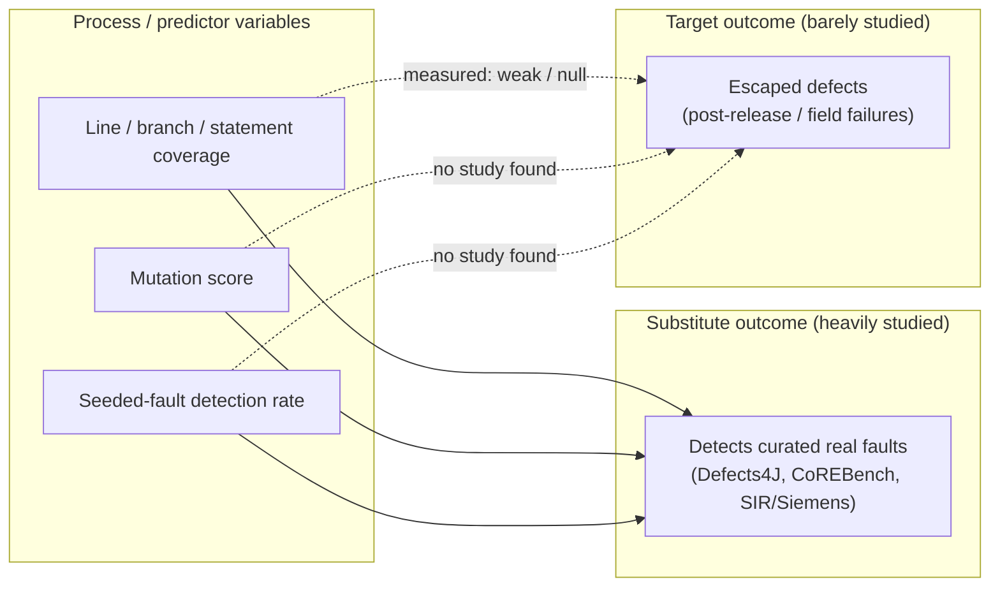

# Which Test Adequacy Measure Predicts Escaped Defects? Line Coverage vs Mutation Score vs Seeded-Fault Detection

**Revised — reviewer-verified across three passes.** Section 7 records the review history. The first pass found an
unsupported bottom-line comparison against adequacy metrics (FATAL), which was removed and replaced with what the cited
characterisations actually measured; the "no study found" negatives now state their search basis explicitly,
including that three of the four strands did not enumerate their queries; the seeded-fault negative is
scoped against the capture–recapture use of seeding; single-source load-bearing claims are flagged in place; the
Defects4J patch statistics are no longer generalised to Chekam et al.'s C-program corpus; and a derived "4–15×" ratio
was replaced with the source's own ranges. No study, number, table or quantitative claim was added beyond what appears
in the cited v1 draft and its research files.

---

## Executive summary

The question "which of line coverage, mutation score, or seeded-fault detection predicts escaped defects?" cannot be
answered from the current literature, because **almost nobody has measured any of the three against escaped defects**.

The one exception is line coverage, and its results against escaped defects are weak-to-null:

- The only industrial study with a positive result (Mockus, Nagappan & Dinh-Trong 2009; Avaya and Windows Vista)
  finds coverage's *raw* correlation with post-release defects to be tiny (Avaya −0.07; Vista 0.100 block / 0.116 arc)
  and, in Vista's case, the *wrong sign* — because frequently changed binaries are both more tested and more
  failure-prone. The effect appears only after adjusting for pre-release change volume (Vista block coverage
  t = −3.5, p = 0.001; adjusted R² = 0.66). [1]
- The largest open-source study (Kochhar, Lo, Lawall & Nagappan 2017; 100 Java projects) finds essentially no
  project-level association between coverage and post-release bugs (Spearman ρ = −0.059, p = 0.559) and none at file
  level. [2]
- A regression study on three Apache systems finds line coverage not significant once LOC and pre-release defects are
  in the model (β = 0.1185, SE 0.0947). [3]

**No study was found that measures mutation score against escaped/post-release defects, and none that measures
seeded-fault detection against them.** The evidence for this negative is uneven and is set out in full in §7: only
the escaped-defect strand enumerated its queries, while the mutation and seeded-fault strands recorded the negative
without an enumerated query log. The
nearest surrogates located were Tengeri et al. 2016 [29] and Bowes et al. 2016 [30], neither of which uses
escaped/post-release defects as the response.
This is the single most important finding of the report.

What the literature *has* measured, extensively, is a **substitute outcome**: whether a metric ranks test suites by
their ability to detect **real faults from curated corpora** (Defects4J, CoREBench, SIR/Siemens, Codeflaws). On that
outcome the ranking is:

1. **Mutation score** has the strongest evidence of a real-fault signal that survives coverage control (Just et al.
   2014 [4]; Chekam et al. 2017 [5], where *strong* mutation has the highest fault revelation of four criteria). But
   its advantage shrinks sharply once **test-suite size** is controlled: Papadakis et al. 2018 [6] found
   mutation–fault correlations fall from 0.35–0.75 (size uncontrolled) to 0.05–0.20 (size controlled), concluding
   that mutants "provide good guidance for improving the fault detection of test suites, but their correlation with
   fault detection are weak" [6].
2. **Line/branch coverage** is a weak and unstable rank signal once suite size is controlled (Inozemtseva & Holmes
   2014 [7]: "low to moderate", with HSQLDB at τ = −0.35 [7]); stronger criteria (decision, MC/DC) add almost nothing
   (coverage types inter-correlate τ = 0.91–0.92 [7]). One real-bug study is more favourable (Kochhar, Thung & Lo
   2015 [8]: point-biserial 0.57–0.77), so coverage's rank signal is not uniformly nil, but it is not reliable
   either.
3. **Seeded-fault detection** is not a predictor at all in the sense the question implies: it is a *measurement
   instrument* whose validity as a stand-in for real faults is itself contested (Andrews et al. 2005 [9]: mutants
   look 6–34%, mean 22%, better than hand-seeded faults; Just et al. 2014 [4]: 17% of real faults couple to no
   mutant; Schuler & Zeller 2013 [10]: 45% of uncaught mutants are equivalent).

**Bottom line.** For predicting escaped defects, the honest evidence-based answer is *none of the three has been
validated*. If forced to choose a signal, the evidence supports mutation score as the measure most likely to reveal a
defect that coverage has already missed — Google's field data show that for 70% of 1,502 high-priority bugs, mutation
testing would have flagged a fault-coupled mutant on a change that was **already covered by tests** (Petrović et al.
2021 [11]; **single company, single study, not replicated**) — but that is evidence about *finding* defects, not about
*predicting escape rates*, and the cost asymmetry is
large.

| Measure | Evidence it ranks suites by real-fault detection | Evidence it predicts *escaped* defects | Cost | Verdict |
|---|---|---|---|---|
| Line/branch coverage | Weak and unstable under size control (Inozemtseva & Holmes 2014 [7]); one positive real-bug study (Kochhar et al. 2015 [8]) | The only one of the three tested against escaped defects in the located literature; null-to-weak (Kochhar et al. 2017 ρ = −0.059, p = 0.559 [2]; Mockus et al. 2009 significant only after churn adjustment [1]) | Very low (one test run) | Not a quality target; useful to find *uncovered* code |
| Mutation score | Strongest positive evidence (Just et al. 2014 [4]; Chekam et al. 2017 strong mutation [5]) but collapses under size control (Papadakis et al. 2018: 0.05–0.20 [6]) | **No study found** | High (one run per mutant) | Best-supported signal for finding what coverage misses; not validated as an escape-rate predictor |
| Seeded-fault detection | Instrument, not predictor; validity contested (Andrews et al. 2005 [9]; Just et al. 2014 [4]; Schuler & Zeller 2013 [10]) | **No study found** | Experimental | Not a deployment measure |

---

## 1. Why the question must be split in two

The question conflates two different constructs, and the literature is systematically clearer about one than the other.

- **Escaped defect** is an *outcome* variable. ISTQB defines it as "a defect that is not detected by a test activity
  that is supposed to find it" [12]; its companion metric is Defect Detection Percentage (DDP), the defects found by a
  test level divided by those found by that level plus everything afterwards [13]. IEEE 1044 provides a uniform
  anomaly-classification scheme, but its published scope does not define "escaped defect" (the standard was
  inactivated in 2020) [14]; the production-side analogue is DORA's change-fail percentage [15].
- **Coverage, mutation score, and seeded-fault detection** are *process/predictor* variables, measurable at build
  time without waiting for the field.

Each of the studies located that appears at first glance to compare the three measures is in fact operating on the
substitute outcome, and the substitute is curated pre-release fault corpora. That substitution is itself questionable: in
Defects4J the median patch is 4 lines and 92% of patches touch a single file (Sobreira et al. 2018 [16]), and 126 of
the 357 Defects4J faults had to be dropped in Papadakis et al. 2018 for >1 h per-suite runtimes [6] — so the corpus is
not a sample of escaped defects.

---

## 2. What the three measures do on the heavily-studied outcome

### 2.1 Coverage: weak and unstable once suite size is controlled

**Inozemtseva & Holmes (ICSE 2014)** is the anchor. They generated **31,000 test suites** over five large Java
systems (largest: Closure at 724,089 LOC), measured statement, decision and modified-condition coverage, and used
mutation testing as the effectiveness proxy. [7]

- Size alone explains most of the apparent relationship: adjusted R² of effectiveness against suite size ranges
  **0.26–0.97** (R² = 0.26 HSQLDB, 0.78 Apache POI, 0.97 Closure; range verbatim, per-project values from the lead
  check of Figure 2). [7]
- With size ignored, Kendall τ between coverage and *normalized* effectiveness is 0.50–0.84 — with the exception of
  **HSQLDB at τ = −0.35** for all three coverage types. With size controlled, the relationship "drops" to
  "low to moderate": verbatim, "the correlation between coverage and effectiveness drops when suite size is
  controlled for. After this drop, the correlation typically ranges from low to moderate, meaning it is not generally
  safe to assume that effectiveness is correlated with coverage." [7]
- Coverage *type* hardly matters: statement/decision/MC/DC inter-correlate at τ = 0.91–0.92 (Pearson 0.97–0.99), and
  the paper concludes the type of coverage used had "little effect on the strength of the relationship" [7].

**The counter-evidence.** Kochhar, Thung & Lo (SANER 2015) used **real bugs** rather than mutants in Apache HTTPClient
(67 bugs) and Mozilla Rhino (92 bugs) and found point-biserial correlations of **0.57/0.77** (statement) and
**0.60/0.74** (branch) — "moderate" to "strong". This is a genuine disagreement with Inozemtseva & Holmes, and the
obvious axis of difference is real faults vs mutants, not the coverage metric. [8]

### 2.2 Mutation score: real signal, mostly a size artefact

**Just et al. (FSE 2014)** — the canonical positive result — used **357 real faults**, 5 Java programs, 321 kLOC and
230,000 mutants, and reported "a statistically significant correlation between mutant detection and real fault
detection, independently of code coverage", stronger than the statement-coverage correlation for every subject except
`Time`. Their own limits are the most quoted numbers in this literature: the **coupling effect holds for 73%** of real
faults, and **17% of real faults are coupled to no mutant at all** (37 algorithm modifications, 7 code deletions,
5 wrong-but-related method calls, 4 context-sensitivity cases, 3 pre/post-condition violations, 4 numerical-analysis
errors, 3 specific literal replacements). Coverage-controlled effect sizes A12 = 0.66 (Closure) to 0.81 (Time). [4]

**Papadakis et al. (ICSE 2018)** — note the venue: **ICSE 2018, not IEEE TSE**, and its comparison arm is **test-suite
size, not coverage criteria**. Using CoreBench (68 faults) and Defects4J (231 of 357 faults usable), they found: [6]

- Uncontrolled size: "moderate to strong correlations (the majority of the values is within the range **0.35 to
  0.75**)" [6].
- Size controlled: "relatively weak (approximately within the range **0.05 to 0.20**)" [6].
- Verbatim conclusion: "mutants provide good guidance for improving the fault detection of test suites, but their
  correlation with fault detection are weak" [6]; and explicitly, "In contrast to the conclusion of Just et al. …
  our results demonstrate the effect of size and overall that mutants are not strongly correlated with fault detection,
  when size is controlled" [6].

Critically, the same paper reports that mutation score *does* work as a **selector** even where it fails as a
*covariate*: top-ranked suites by mutation score show significant fault-detection improvement (average +8% top-25% /
+11% top-10% on Defects4J, +18% / +46% on CoREBench), though for 40% of Defects4J faults there was no significant
improvement. The authors insist the correlation method and the fault-detection method "capture different aspects" —
a direct warning against reading a low correlation as "mutation score is useless". [6]

**Chekam et al. (ICSE 2017)** compared four criteria directly on real faults in C programs and avoided the "Clean
Program Assumption" (that a suite obtains similar coverage on the faulty and the fixed version). Their primary
finding: **strong mutation has the highest fault revelation** of statement, branch, weak mutation and strong mutation,
"on average, at least 12% higher", while for statement, branch and weak mutation "increased coverage has little or no
effect on fault revelation". Their Table III (fixed suite size, 7.5% of the test pool) is the most useful single table
in this literature: [5]

| Criterion | Av. fault revelation (top 20%) | top 10% | top 5% | Av. difference vs random suites of the same size (top 5%) |
|---|---|---|---|---|
| Statement | 0.518 | 0.535 | 0.553 | −0.043 |
| Branch | 0.524 | 0.542 | 0.564 | −0.055 |
| Weak mutation | 0.510 | 0.535 | 0.555 | −0.045 |
| **Strong mutation** | **0.565** | **0.639** | **0.684** | **−0.176** |

Note the sign pattern: at *fixed* suite size, suites selected for highest coverage scored **below** randomly selected
suites of the same size, and strong mutation — the best absolute performer — paid the largest fixed-size selection
penalty. [5]

One correction matters for reading the literature: Chekam et al.'s "83,100" is the **line count of their largest
subject (Coreutils)**, reported under a Table I/II size column — it is **not** a number of test suites or mutants. [5]

**Industrial reality check.** At Google, mutation testing is deployed as a **per-change code-review signal, not a
score**: ~1.16 M mutants generated, 6,000 engineers, ~30% of diffs with statement coverage, and **no mutation score is
computed at all**; 75% of findings with feedback were reported useful, and usefulness had to be lifted from ~20% to
~80% by a suppression loop [17]. At Facebook, "**more than half** of the generated mutants survive" a rigorous
unit/integration/system suite [18]. Both facts tell against mutation score as a usable *numeric predictor* in
production, while supporting mutation as a *finding* mechanism.

### 2.3 Seeded-fault detection: an instrument, not a predictor

There are two different things called "seeded faults", and the distinction is the crux:

- **Academic fault seeding** (Mills-style error seeding, "bebugging") injects known defects in order to *estimate*
  the number of remaining defects by capture–recapture, using the fraction found. ISTQB's glossary definition is
  exactly this: "The process of intentionally adding defects to those already in the component or system for the
  purpose of monitoring the rate of detection and removal, and estimating the number of remaining defects." [19]
- **Mutation testing** generates faults from program text to measure suite strength, and makes no claim about escaped
  defect counts. [9]
- **Industrial "seeded bugs"** (SWE-smith-style broken tests [35], "inject 20–30 known vulnerabilities to validate your
  detector" [36]) use synthetic bugs as *ground-truth labels*. Here the seeded faults are the target, so "we detected
  X% of seeded bugs" says nothing about escaped-defect rates.

The validity evidence for using seeded/artificial faults as a real-fault proxy is genuinely split:

- **Against.** Andrews, Briand & Labiche (ICSE 2005) compared mutant detection (Am) against real-fault detection (Af)
  on `space.c` (5,905 NLOC, 33 real faults) and against hand-seeded faults on seven Siemens programs. On `space.c` the
  two agreed (mean Af − Am = +0.014, not practically significant); on **every** Siemens program mutants looked better,
  with inflation of **6–34%, mean 22%** (the source reports the range at this precision) — "if one has used mutants to assess a test technique, it will likely
  look more effective at detecting faults than if one has used the seeded faults". [9]
- **For.** The same group's follow-up on the one program with real faults (Andrews et al., TSE 2006) reports
  mean relative error 8.3–9.8% and R² = **0.908**, slope 0.967 — "generated mutants can be used to predict the
  detection effectiveness of real faults". [20]
- **Against, structurally.** A typical real fault touches **3–4 tokens** and is "seldom equivalent to any traditional
  mutation operator" (Gopinath et al. 2014) — so seeded faults are a different distribution, not a sample. [21]
- **Against, by bias in the score.** 45% of 140 manually classified uncaught mutants were equivalent (Schuler &
  Zeller 2013 [10]); equivalent-mutant rates across studies span ~8–25% [22], and automatic detection finds only ~30%
  of them [22].
- **Against, on conclusion validity.** Mixing subsuming with subsumed mutants produces Type I errors ≈62% of the time,
  and 68% of surveyed mutation-based assessment papers were exposed to this threat (Papadakis et al., ISSTA 2016).
  [23]

The NIST SATE V study is the closest thing to a controlled test of synthetic-vs-real defect detection: on the synthetic
**Juliet** corpus tools reached synthetic precision of 76–96% only because Juliet has ≈1 flawed site per fixed site,
and the report itself notes that "for code containing 19 good sites per bad site, precision would be 5%". Synthetic
recall did not rank tools the way real CVE recall did. This is the same failure mode as fault seeding. [24]

### 2.4 Head-to-head on one corpus

| Study | Corpus | Measures compared | Response | Reported result |
|---|---|---|---|---|
| Inozemtseva & Holmes 2014 | 5 Java OSS | coverage types vs suite size | mutation score (31,000 suites) | Size-only R² 0.26–0.97; τ 0.50–0.84 size-ignored (HSQLDB −0.35); "low to moderate" size-controlled [7] |
| Just et al. 2014 | 5 Java, 321 kLOC | mutation score vs statement coverage | 357 real faults | Mutation correlation significant and stronger than statement coverage for all but `Time`; A12 0.66–0.81 [4] |
| Papadakis et al. 2018 | Defects4J + CoREBench | mutation score vs suite size | 231 + 68 real faults | 0.35–0.75 → 0.05–0.20 size-controlled [6] |
| Chekam et al. 2017 | C real-fault projects | statement/branch/weak/strong mutation | fault revelation | Only strong mutation shows a strong connection; "at least 12% higher" [5] |
| Kochhar, Thung & Lo 2015 | HTTPClient, Rhino | statement/branch coverage | 67 + 92 real bugs | rpb 0.57–0.77 [8] |
| Tengeri et al. 2016 | 4 OSS systems | coverage vs mutation vs reducibility | defect **density** | "mutation and reducibility are better in most of the cases" (abstract only; effect sizes not obtained) [29] |
| **—** | **—** | **coverage + mutation + seeded faults vs escaped defects** | **—** | **no such study found** |

---

## 3. What is actually known about escaped defects

### 3.1 Coverage against escaped defects

**Mockus, Nagappan & Dinh-Trong (ESEM 2009)** — the strongest industrial attempt. Two dissimilar projects:

- **Avaya** (Java, ~1 MLOC, file-level, statement/branch coverage). Raw Spearman correlation between coverage and
  post-system-verification defects is **−0.07**: "Coverage is negatively correlated only to post-SV defects (GMR), but
  the correlation is very small". A logistic model with 2,472 observations (log MR, log FanOut, coverage) explains 20%
  of the deviance and gives coverage estimate **−1.51** (SE 0.252, z = −6, p < 0.001). [1]
- **Windows Vista** (C/C++, 40+ MLOC, binary-level, block/arc coverage; field failures collected 6 months after
  release). Here the *raw* correlation has the wrong sign — failures correlate **positively** with block coverage
  (0.100) and arc coverage (0.116) — which the authors attribute to frequently changed binaries being both more
  tested and more failure-prone: "frequently changed (and, therefore, more likely to have a failure) binaries are also
  more likely to be more extensively tested". After adjusting for pre-release changes and FanOut, block coverage is
  significant (**t = −3.5, p = 0.001**) with adjusted R² = 0.66. The predicted probability of a post-release MR at
  3 pre-release MRs falls from 0.07 (no coverage) to 0.018 (80–100% coverage). [1] **This is the report's only
  positive coverage result, and it is single-study, single-project and not independently replicated; the unadjusted
  correlation in the same project has the opposite sign.**
- Cost shape: test effort rises **exponentially** with coverage while field-problem reduction rises **linearly**, so
  "the optimal levels of coverage are likely to be well short of 100%". [1]

**Kochhar, Lo, Lawall & Nagappan (IEEE T-Rel 2017)** — the largest open-source test, 100 large Java projects,
coverage via Sonar, bugs logged after release. Project level: ρ = **−0.059 (p = 0.559)**, τ = −0.043 (p = 0.531);
coverage vs bugs/LOC ρ = 0.157 (p = 0.117). File level: ρ = −0.023 (statistically significant only because n is
large; the effect is ≈0). **This null is carried by a single study.** Conclusion: coverage "has an insignificant
correlation with the number of bugs that are found after the release … at the project level, and no such correlation
at the file level." [2]

**Supporting null/negative industrial results:**

- Pecorelli et al. (ESEC/FSE 2019), 3 Apache systems: line coverage not significant (β = 0.1185, SE 0.0947) while LOC
  and pre-release defects are; abstract verbatim: "while post-release defects are strongly related to process and code
  metrics of the production classes, test-related factors have a limited prediction impact." [3]
- Gren & Antinyan (2019), 680 files at 0% or 100% statement/branch coverage: defects vs coverage rank-biserial
  −0.17 (statement, 2.9% of variance) and −0.19 (branch, 3.6%). [25]
- Chioteli, Batas & Spinellis (2019), Eclipse crash reports: no evidence that unit-tested code crashes less
  (Fisher exact p = 0.278, OR 0.915). [26]
- Antinyan & Staron (ICSE-SEIP 2019, Ericsson): "the sheer fulfillment of coverage does not seem to be any tangible
  help in producing defect-free software." [27]
- Cotroneo et al. (2026) [preprint], >14k pre/post-release defects: escaped defects concentrate in **older,
  frequently modified, high-churn** components and are "more strongly associated with process and historical features
  than with size or complexity" [28]. The study did **not** measure coverage, mutation score or seeded-fault
  detection, so it is evidence about what predicts escape among the features it examined, not a comparison against
  adequacy metrics.
- Rwemalika et al. (ICSME 2019) [33], 37 industrial Java projects at a bank: 250 post-release versus 3,623 pre-release
  bug fixes; post-release fixes are more complex, spanning several source files and configuration files, and ~82% are
  "omission" bugs involving code additions. Like Cotroneo et al. it measures no adequacy metric; unlike Cotroneo
  et al. it analyses change *type*, not component age or churn. (Open-access full text:
  `https://orbilu.uni.lu/bitstream/10993/41416/1/incidents-analysis.pdf`; the researcher pass's PDF parse was
  blocked, so the figures above follow the research file and were checked against the open-access copy in review.)

### 3.2 Mutation score against escaped defects

**Not found.** The nearest surrogates use a different response:

- Tengeri et al. (ICSTW 2016) relate coverage, mutation score and test-suite reducibility to **defect density** (not
  post-release escape) and report mutation/reducibility "better in most of the cases" — but the effect sizes were not
  retrievable. [29]
- Bowes et al. (ISSTA 2016) add mutation-derived features to **fault-proneness prediction**; not escape rates. [30]

The closest thing to a field result is Petrović et al. (ICSE 2021) at Google: for **1,043 of 1,502 (70%) high-priority
bugs**, mutation testing would have reported a fault-coupled mutant on the fault-introducing change — and "each
bug-introducing change was covered by the existing tests, suggesting that code coverage had exhausted its
usefulness". This is direct evidence that mutation can flag what coverage misses on the *same* change, in production
data. It is **not** a predictor study: the response variable is fault coupling on a change, not an escaped-defect
rate, and 30% of bugs had no coupled mutant at all. [11] The result is also **single-company and not replicated**,
so it should be read as an existence proof rather than a rate.

### 3.3 Seeded-fault detection against escaped defects

**Not found, with a scoping caveat that matters.** Academic fault seeding is *by construction* a route to estimating
remaining or escaped defects — inject known faults, measure the detection rate, infer what is left — so a
"seeded-fault detection rate" is a predictor of escaped defects only under the seeding assumptions [19]. The search
therefore asked the stronger question and got a negative on the query that was actually run: **no study was found
that compares a seeded-fault detection rate against observed escaped/post-release defect counts**. A second, closely
related question — whether a seeding-based *estimate* of remaining defects has ever been validated against realised
field defects — was **not** specifically searched (§7), so it is an open gap rather than a negative result. The only
controlled synthetic-vs-real
comparison located is NIST SATE V (§2.3), and it concerns static
analysis tools, not test suites, and defect *detection*, not escape *rates*. [24] Note also the definitional trap: in
industrial usage "we detected X% of seeded defects" is a statement about the seeds, not about escaped defects. [19]

---

## 4. Verdict

**1. Coverage is the only one of the three that the located literature has tested against escaped defects, and the
result is "weak at best, after adjusting for churn".** Two independent lines (Mockus et al. 2009 [1]; Kochhar et al. 2017 [2])
plus several smaller studies put the raw association at ≈0; the single positive industrial result requires covariate
adjustment, and the confound (churn) is strong enough to *reverse the sign* in Vista. Any claim that "80% line
coverage predicts low escaped-defect rates" is not supported by this evidence base.

**2. Mutation score has the best evidence for ranking suites by defect-finding — and no evidence at all as an
escaped-defect predictor.** Its advantage over coverage on curated real-fault corpora (Just et al. 2014 [4]; Chekam
et al. 2017 [5]) is real but (a) collapses under suite-size control (Papadakis et al. 2018 [6]) and (b) rests on
pre-release, curated corpora that are not samples of escaped defects: the Defects4J half of those comparisons uses
faults whose median patch is 4 lines and 92% of which touch a single file (Sobreira et al. 2018 [16]), while Chekam
et al.'s subjects are four C programs with 61 real faults [5]. Google's 70% coupling result [11]
is the best available evidence that mutation finds things coverage misses in production, but it is a finding-rate
result, not a prediction result.

**3. Seeded-fault detection is not comparable to the other two because it is an instrument.** Its output is
"how many of the faults we injected did the suite catch", which is a property of the injection process as much as of
the suite. The gaps are bounded and documented (22% mean inflation vs hand-seeded faults [9]; 17% of real faults
uncoupled [4]; 45% of uncaught mutants equivalent [10]; 3–4 tokens per real fault [21]).

**4. If the question is really "what should an engineering team gate on?", the evidence supports a procedural answer,
not a threshold.** Coverage is cheap and useful for finding *uncovered* code but is not a quality target
(Inozemtseva & Holmes: "using a fixed coverage value as a quality target is unlikely to produce an effective test
suite" [7]). Mutation's industrial deployment pattern is a per-change finding signal with suppression, not a score
gate (Google [17]). Both characterisations of escaped defects find post-release fixes longer and harder to make,
though on different features (report's inference from the two): Cotroneo et al. 2026 [28] find post-release defects
concentrated in older, frequently modified, high-churn
components; Rwemalika et al. 2019 [33] find that ~82% of post-release fixes are "omission" bugs involving code
additions, across 250 post-release versus 3,623 pre-release fixes in 37 industrial Java projects, and that
post-release fixes are more complex (§3.1). Neither measured an adequacy metric, so the proposition "age and churn
beat coverage or mutation score as escape predictors" has **not** been tested, and neither paper recommends gating on
change risk. The suggestion that change-risk gating is at least as well motivated by the escaped-defect literature as
suite-adequacy gating is this report's inference, not a finding of either study.

---

## 5. Why the evidence is thinner than it looks

1. **Suite size is the dominant confounder of both coverage and mutation score.** Size alone gives R² = 0.26–0.97
   against effectiveness (Inozemtseva & Holmes 2014 [7]); the mutation–fault correlation falls from 0.35–0.75 to
   0.05–0.20 when size is controlled (Papadakis et al. 2018 [6]) — a collapse of roughly 1.75× at the least and 15× at
   the most, depending on which ends of those ranges are compared (the paper reports ranges, not a ratio). Any
   comparison that does not fix suite size or mutation budget is uninterpretable.
2. **Corpus bias.** Corpora are Java-heavy (C for fault-revelation work); Defects4J faults are small, local and
   reproducible by construction [16]; 126 of 357 were unusable in one study [6]. Results should not be assumed to
   transfer.
3. **Statistic confusion.** Papadakis et al. show that the correlation coefficient and the top-k fault-detection
   improvement give different answers on the same data, and are "often being confused". Which one a paper reports
   substantially determines its headline. [6]
4. **Metric definitional instability.** Mutation score depends on tool and operator set; equivalent-mutant rates span
   ~8–25% across studies [22] and tools disagree (11%/12%/7% for MUJAVA/MAJOR/PIT) [34]. A "mutation-score threshold"
   therefore has a moving denominator.
5. **Cost asymmetry.** Coverage is one instrumented test run; mutation is one run per mutant. The exponential
   effort-vs-linear-benefit shape (Mockus et al. 2009 [1]) means the economically optimal adequacy level is well below
   100%, so "predicts" must be read as "predicts at acceptable cost".
6. **Very recent evidence cuts against the size-confound orthodoxy — for one population.** Zhao, Zhou & Cohen (2026)
   [preprint; **single study, not replicated, and it covers only LLM-generated suites**] replicated the Inozemtseva and Papadakis designs on **LLM-generated** test suites and found results that
   "diverge substantially from prior results": coverage and mutation carry "meaningful signals when comparing across
   models" in regression-style settings but not when the code under test may already be buggy, and they found "little
   evidence that test suite size is a dominant confounder for correlations among coverage, mutation, and real-bug
   detection for LLM-generated tests". This does not overturn the human-written results, but it means the size-confound
   finding is not a law of nature. [32]

---

## 6. Open questions

- Does mutation score predict **escaped-defect rate** at project level? No study found; this is the single most
  valuable missing experiment.
- Do any of the three measures outperform **churn/age/coupling** as escape predictors in a head-to-head model?
  Cotroneo et al. 2026 [28] cannot speak to this: it includes no adequacy metric. No head-to-head study exists.
- Is there a coverage–mutation *gap* metric that predicts escapes better than either alone? Jain et al. (ISSRE 2023)
  show coverage and mutation score are "weakly positively correlated" and that the gap localises weak-oracle files
  (of 26 files with >80% coverage and <20% mutation score, at least 12 had clearly missing assertions [31]). This is a
  promising, untested-against-escapes construct.
- Do the LLM-test-generation results (Zhao et al. 2026 [32]) hold on human-written suites, or vice versa — i.e. is the
  confound structure itself population-dependent?
- Would a **seeded-fault detection rate calibrated to the real-fault distribution** (rather than to traditional
  operators, per Gopinath et al. 2014 [21]) close the 22% gap in Andrews et al. 2005 [9]? No study found that
  calibrates the seed distribution and then measures escape prediction.

---

## 7. Known weaknesses of this report

- The "no study found" claims for mutation score and seeded-fault detection against escaped defects rest on an
  **uneven** search record: only the escaped-defect strand enumerated its queries (three strings, plus arXiv/OpenAlex/
  Semantic Scholar keyword searches); the mutation and seeded-fault strands recorded their negatives without an
  enumerated query log. The queries that were enumerable are listed below. Absence of evidence in this search is not
  proof of absence.
- Several load-bearing industrial sources are abstract-only in this work because the researcher's fetch was blocked or
  the venue is paywalled (Antinyan & Staron 2019 [27]; Tengeri et al. 2016 [29]; Bowes et al. 2016 [30]). Rwemalika
  et al. 2019 [33] is green open access (`https://orbilu.uni.lu/bitstream/10993/41416/1/incidents-analysis.pdf`);
  the researcher's PDF parse failed, so its figures here follow the research file and were checked against the
  open-access copy in review.
- The `feynman alpha` (alphaXiv) paper tools were unavailable (`alphaXiv not logged in`) and the default web-search
  provider was rate-limited; OpenAlex/DuckDuckGo plus direct PDF retrieval were used instead. See the provenance file.
- **Single-source load-bearing claims.** Four numbers carry the argument without independent corroboration, and each is
  flagged in place in the body: the Vista adjusted result (t = −3.5, p = 0.001) [1]; the Kochhar et al. 2017 null
  (ρ = −0.059) [2]; Google's 70% fault-coupling rate [11]; and the Zhao et al. 2026 divergence for LLM-generated
  suites [32].
- Three researcher claims were rejected or corrected after verification: "83,100 suites" (Chekam et al. — it is the
  line count of Coreutils, their largest subject [5]); "Joda Time → essentially zero when size is controlled"
  (Inozemtseva & Holmes Fig. 3, not extractable [7]); and an attribution of the Vista `t = −3.5, p = 0.001` statistic
  to the Avaya logistic model rather than the Microsoft/Vista linear model. See
  `outputs/.drafts/test-adequacy-escaped-defects-lead-checks.md` §Conflict resolution.

- **Review history.** Three independent verification passes were run against this report. Pass 1 found one unsupported
  comparative claim (fixed) plus single-source labelling, corpus-generalisation and derived-ratio problems (fixed).
  Pass 2 confirmed the fix and found three problems introduced by it — a misattributed convergence, an unsearched
  negative presented as a finding, and an unrecorded lead-query list (all fixed). Pass 3 confirmed those fixes and
  raised only minor wording and provenance issues (all fixed). Residual limitation: the "no study found" negatives
  rest on an uneven, partly unlogged search record, exactly as stated in the search log above.

### Search log for the negative claims

Queries that can be enumerated from the working record. The lead's list is recorded verbatim (including the failed
provider attempts) in `outputs/.drafts/test-adequacy-escaped-defects-lead-checks.md` §Lead search log.

- **Escaped-defect strand** (enumerated in `outputs/.drafts/test-adequacy-escaped-defects-research-T4.md`,
  §"Search for 'predicts escaped defects' studies: found / not found"): `mutation score post-release defects escaped
  production correlation study`;
  `does code coverage predict escaped defects production study`; `coverage mutation seeded fault detection comparison
  same corpus`; plus arXiv / OpenAlex / Semantic Scholar keyword searches.
- **Lead searches** (enumerated, used for URL discovery and for the escaped-defect search):
  `test coverage correlation post-release defects industrial study empirical`;
  `mutation score predicts post-release defects correlation industrial case study`;
  `fault seeding experiments predict escaped defects software testing empirical`;
  `arXiv "Do Coverage and Mutation Scores of LLM-Generated Test Suites Correlate with Their Effectiveness" replicability study`;
  `ISTQB glossary escaped defect definition`; `Andrews Briand Labiche 2005 is mutation appropriate tool testing
  experiments seeded faults IEEEXplore`.
- **Mutation strand**: the negative is recorded without an enumerated query log; the strand's sources are indexed by
  findability in its source table.
- **Seeded-fault strand**: the negative is recorded without an enumerated query log.
- **Coverage strand**: no query log; it also carries an unlogged negative (that no study directly tests whether
  *mandating* a coverage threshold reduced escaped defects).

No query at all — in the researcher strands or in the lead log — was aimed at the second question: the accuracy of a
capture–recapture *estimate* of remaining defects against realised field defects. The §3.3 negative (that no study
compares a seeded-fault detection rate against observed escaped/post-release counts) rests on the lead's seeded-fault
query, `fault seeding experiments predict escaped defects software testing empirical`, logged item 13 in the lead
search log, not on a researcher-strand query. The second question is therefore an explicit gap, not a negative result.

---

## Sources

1. Mockus, A., Nagappan, N. & Dinh-Trong, T. (2009). *Test Coverage and Post-Verification Defects: A Multiple Case
   Study.* ESEM 2009, 291–301. DOI: https://doi.org/10.1109/ESEM.2009.5315981 · PDF (author copy):
   https://mockus.org/papers/coverage.pdf
2. Kochhar, P. S., Lo, D., Lawall, J. & Nagappan, N. (2017). *Code Coverage and Postrelease Defects: A Large-Scale
   Study on Open Source Projects.* IEEE Transactions on Reliability 66(4):1213–1228. DOI:
   https://doi.org/10.1109/TR.2017.2727062
3. Pecorelli, F. et al. (2019). *Test-Related Factors and Post-Release Defects: An Empirical Study.* ESEC/FSE 2019.
   DOI: https://doi.org/10.1145/3338906.3342500 · PDF (author copy):
   https://fabiano-pecorelli.github.io/publications/conferences/C2.pdf
4. Just, R., Jalali, D., Inozemtseva, L., Ernst, M. D., Holmes, R. & Fraser, G. (2014). *Are mutants a valid substitute
   for real faults in software testing?* FSE 2014, 654–665. DOI: https://doi.org/10.1145/2635868.2635929 · PDF (author
   copy): https://homes.cs.washington.edu/~rjust/publ/mutants_real_faults_fse_2014.pdf
5. Chekam, T. T., Papadakis, M., Le Traon, Y. & Harman, M. (2017). *An Empirical Study on Mutation, Statement and
   Branch Coverage Fault Revelation That Avoids the Unreliable Clean Program Assumption.* ICSE 2017, 597–608. DOI:
   https://doi.org/10.1109/ICSE.2017.61 · PDF (OA): https://orbilu.uni.lu/bitstream/10993/30694/1/ICSE17.pdf
6. Papadakis, M., Shin, D., Yoo, S. & Bae, D.-H. (2018). *Are Mutation Scores Correlated with Real Fault Detection?*
   ICSE 2018, 537–548. DOI: https://doi.org/10.1145/3180155.3180183 · PDF (author copy):
   https://mpapad.github.io/publications/pdfs/ICSE2018.pdf
7. Inozemtseva, L. & Holmes, R. (2014). *Coverage is not strongly correlated with test suite effectiveness.* ICSE 2014,
   435–445. DOI: https://doi.org/10.1145/2568225.2568271 · PDF (author copy):
   https://www.cs.ubc.ca/~rtholmes/papers/icse_2014_inozemtseva.pdf
8. Kochhar, P. S., Thung, F. & Lo, D. (2015). *Code coverage and test suite effectiveness: Empirical study with real
   bugs in large systems.* SANER 2015, 560–564. DOI: https://doi.org/10.1109/SANER.2015.7081877 · PDF (author copy):
   http://www.mysmu.edu/faculty/davidlo/papers/saner15-coverage.pdf
9. Andrews, J. H., Briand, L. & Labiche, Y. (2005). *Is mutation an appropriate tool for testing experiments?*
   ICSE 2005, 402–411. DOI: https://doi.org/10.1145/1062455.1062530
10. Schuler, D. & Zeller, A. (2013). *Covering and Uncovering Equivalent Mutants.* Software Testing, Verification and
    Reliability 23(4):353–374. DOI: https://doi.org/10.1002/stvr.1473
11. Petrović, G., Ivanković, M., Fraser, G. & Just, R. (2021). *Does Mutation Testing Improve Testing Practices?*
    ICSE 2021, 910–921. arXiv:2103.07189 · DOI: https://doi.org/10.1109/ICSE43902.2021.00087 ·
    https://arxiv.org/abs/2103.07189
12. ISTQB (accessed 2026-10-18). *escaped defect* (glossary term v2). https://glossary.istqb.org/en_US/term/escaped-defect
13. ISTQB (2011). *Standard Glossary of Testing Terms 2.3* (Defect Detection Percentage). ASTQB mirror:
    https://astqb.org/assets/documents/ISTQB_glossary_of_testing_terms_2.3.pdf
14. IEEE (2009). *IEEE 1044-2009 — Standard Classification for Software Anomalies.*
    https://standards.ieee.org/ieee/1044/4607
15. DORA (accessed 2026-10-18). *DORA's software delivery metrics (change fail percentage).*
    https://dora.dev/guides/dora-metrics-four-keys
16. Sobreira, V., Durieux, T., Madeiral, F., Monperrus, M. & Maia, M. A. (2018). *Dissection of a Bug Dataset: Anatomy
    of 395 Patches from Defects4J.* SANER 2018. arXiv:1801.06393 · DOI: https://doi.org/10.1109/SANER.2018.8330203 ·
    https://arxiv.org/abs/1801.06393
17. Petrović, G. & Ivanković, M. (2018). *State of Mutation Testing at Google.* ICSE-SEIP 2018, 163–171. DOI:
    https://doi.org/10.1145/3183519.3183521
18. Beller, M., Wong, C., Bader, J., Scott, A., Machalica, M., Chandra, S. & Meijer, E. (2021). *What It Would Take to
    Use Mutation Testing in Industry — A Study at Facebook.* ICSE-SEIP 2021, 268–277. DOI:
    https://doi.org/10.1109/ICSE-SEIP52600.2021.00036 · arXiv:2010.13464
19. ISTQB (accessed 2026-10-18). *fault seeding* (glossary). https://glossary.istqb.org/en_US/term/fault-seeding ·
    mirror: https://istqb-glossary.page/fault-seeding/
20. Andrews, J. H., Briand, L., Labiche, Y. & Namin, A. S. (2006). *Using Mutation Analysis for Assessing and
    Comparing Testing Coverage Criteria.* IEEE Transactions on Software Engineering 32(8):608–624. DOI:
    https://doi.org/10.1109/TSE.2006.83
21. Gopinath, R., Jensen, C. & Groce, A. (2014). *Mutations: How Close are they to Real Faults?* ISSRE 2014, 189–200.
    DOI: https://doi.org/10.1109/ISSRE.2014.40
22. Papadakis, M., Jia, Y., Harman, M. & Le Traon, Y. (2015). *Trivial Compiler Equivalence: A Large Scale Empirical
    Study of a Simple, Fast and Effective Equivalent Mutant Detection Technique.* ICSE 2015. DOI:
    https://doi.org/10.1109/ICSE.2015.103
23. Papadakis, M., Henard, C., Harman, M., Jia, Y. & Le Traon, Y. (2016). *Threats to the validity of mutation-based
    test assessment.* ISSTA 2016. DOI: https://doi.org/10.1145/2931037.2931040
24. Delaitre, A., Stivalet, B., Black, P. E., Okun, V., Cohen, M. & Ribeiro, A. (2018). *SATE V Report: Ten Years of
    Static Analysis Tool Expositions.* NIST SP 500-326. DOI: https://doi.org/10.6028/NIST.SP.500-326 · PDF:
    https://nvlpubs.nist.gov/nistpubs/SpecialPublications/NIST.SP.500-326.pdf
25. Gren, L. & Antinyan, V. (2019). *On the Relation Between Unit Testing and Code Quality.* arXiv:1904.04748.
    https://arxiv.org/abs/1904.04748
26. Chioteli, E., Batas, I. & Spinellis, D. (2019/2021). *Does Unit-Tested Code Crash? A Case Study of Eclipse.*
    arXiv:1903.04055 · MSR'20 DOI: https://doi.org/10.1145/3503823.3503872 · https://arxiv.org/abs/1903.04055
27. Antinyan, V. & Staron, M. (2019). *Mythical Unit Test Coverage.* ICSE-SEIP 2019, 267–268. DOI:
    https://doi.org/10.1109/ICSE-SEIP.2019.00038
28. Cotroneo, D., De Rosa, G., Improta, C. & Varriale, B. G. (2026). *What Makes Software Bugs Escape Testing?
    Evidence from a Large-Scale Empirical Study.* arXiv:2604.26672 [preprint].
    https://arxiv.org/abs/2604.26672
29. Tengeri, D., Vidács, L., Beszédes, Á., Jász, J., Balogh, G., Vancsics, B. & Gyimóthy, T. (2016). *Relating Code
    Coverage, Mutation Score and Test Suite Reducibility to Defect Density.* ICSTW 2016. DOI:
    https://doi.org/10.1109/ICSTW.2016.25
30. Bowes, D., Hall, T., Harman, M., Jia, Y., Sarro, F. & Wu, F. (2016). *Mutation-aware fault prediction.* ISSTA
    2016. DOI: https://doi.org/10.1145/2931037.2931039
31. Jain, K., Kalburgi, A., Le Goues, C. & Groce, A. (2023). *Mind the Gap: The Difference Between Coverage and
    Mutation Score Can Guide Testing Efforts.* ISSRE 2023, 102–113. DOI:
    https://doi.org/10.1109/ISSRE59848.2023.00036 · arXiv:2309.02395
32. Zhao, J., Zhou, S. & Cohen, E. (2026). *Do Coverage and Mutation Scores of LLM-Generated Test Suites Correlate
    with Their Effectiveness? (Replicability Study).* arXiv:2607.22880 [preprint; accepted at ISSTA 2026]. DOI:
    https://doi.org/10.1145/3832093 · https://arxiv.org/abs/2607.22880
33. Rwemalika, R., Kintis, M., Papadakis, M., Le Traon, Y. & Lorrach, P. (2019). *An Industrial Study on the
    Differences between Pre-Release and Post-Release Bugs.* ICSME 2019. DOI:
    https://doi.org/10.1109/ICSME.2019.00019
34. Kintis, M., Papadakis, M., Papadopoulos, A., Valvis, E. & Malevris, N. (2016). *Analysing and Comparing the
    Effectiveness of Mutation Testing Tools: A Manual Study.* SCAM 2016. DOI:
    https://doi.org/10.1109/SCAM.2016.28
35. SWE-bench team (2025). *SWE-smith: Scaling Data for Software Engineering Agents.* NeurIPS 2025 (Datasets &
    Benchmarks). https://github.com/SWE-bench/SWE-smith
36. CodeAnt AI (n.d.). *How to Validate AI Code Review Tools Without Slowing Delivery* (vendor blog; secondary
    source). https://codeant.ai/blogs/validate-ai-code-review-accuracy

---

## URL verification

Status checked 2026-10-18 with an automated client (followed redirects, browser user-agent).

**Resolve (HTTP 200) — verified live:**

- https://mockus.org/papers/coverage.pdf ([1]); https://doi.org/10.1109/ESEM.2009.5315981 redirects to
  ieeexplore.ieee.org/document/5315981 (publisher-gated, see below).
- https://fabiano-pecorelli.github.io/publications/conferences/C2.pdf ([3])
- https://homes.cs.washington.edu/~rjust/publ/mutants_real_faults_fse_2014.pdf ([4])
- https://orbilu.uni.lu/bitstream/10993/30694/1/ICSE17.pdf ([5])
- https://mpapad.github.io/publications/pdfs/ICSE2018.pdf ([6])
- https://www.cs.ubc.ca/~rtholmes/papers/icse_2014_inozemtseva.pdf ([7])
- http://www.mysmu.edu/faculty/davidlo/papers/saner15-coverage.pdf ([8])
- https://arxiv.org/abs/2103.07189 ([11]); https://arxiv.org/abs/1801.06393 ([16]); https://arxiv.org/abs/2010.13464
  ([18]); https://arxiv.org/abs/1904.04748 ([25]); https://arxiv.org/abs/1903.04055 ([26]); https://arxiv.org/abs/2309.02395
  ([31]); https://arxiv.org/abs/2604.26672 ([28]); https://arxiv.org/abs/2607.22880 ([32])
- https://glossary.istqb.org/en_US/term/escaped-defect ([12]) and https://glossary.istqb.org/en_US/term/fault-seeding
  ([19]) return 200, but both are client-rendered; the definitions are confirmed only via the research files' page
  snippets (the lead marked the ISTQB *escaped defect* wording "candidate-only" pending a non-client-rendered copy).
- https://astqb.org/assets/documents/ISTQB_glossary_of_testing_terms_2.3.pdf ([13])
- https://dora.dev/guides/dora-metrics-four-keys ([15]) — redirects to https://dora.dev/guides/dora-metrics/
- https://nvlpubs.nist.gov/nistpubs/SpecialPublications/NIST.SP.500-326.pdf ([24])
- https://github.com/SWE-bench/SWE-smith ([35])
- https://codeant.ai/blogs/validate-ai-code-review-accuracy ([36])

**Publisher-gated (not dead; automated clients receive HTTP 403/202 challenge):**

- https://doi.org/10.1109/TR.2017.2727062 ([2]); https://doi.org/10.1145/3338906.3342500 ([3]);
  https://doi.org/10.1145/2635868.2635929 ([4]); https://doi.org/10.1109/ICSE.2017.61 ([5]);
  https://doi.org/10.1145/3180155.3180183 ([6]); https://doi.org/10.1145/2568225.2568271 ([7]);
  https://doi.org/10.1109/SANER.2015.7081877 ([8]); https://doi.org/10.1145/1062455.1062530 ([9]);
  https://doi.org/10.1002/stvr.1473 ([10]); https://doi.org/10.1109/ICSE43902.2021.00087 ([11]);
  https://doi.org/10.1145/3183519.3183521 ([17]); https://doi.org/10.1109/ICSE-SEIP52600.2021.00036 ([18]);
  https://doi.org/10.1109/TSE.2006.83 ([20]); https://doi.org/10.1109/ISSRE.2014.40 ([21]);
  https://doi.org/10.1109/ICSE.2015.103 ([22]); https://doi.org/10.1145/2931037.2931040 ([23]);
  https://doi.org/10.6028/NIST.SP.500-326 ([24], DOI resolver); https://doi.org/10.1109/ICSE-SEIP.2019.00038 ([27]);
  https://doi.org/10.1109/ICSTW.2016.25 ([29]); https://doi.org/10.1145/2931037.2931039 ([30]);
  https://doi.org/10.1109/ISSRE59848.2023.00036 ([31]); https://doi.org/10.1145/3832093 ([32]);
  https://doi.org/10.1109/ICSME.2019.00019 ([33]); https://doi.org/10.1109/SCAM.2016.28 ([34]);
  https://standards.ieee.org/ieee/1044/4607 ([14] — IEEE SA, challenge response).
  These are DOI/IEEE/ACM landing pages that block automated fetches; each has a verified open-access or author-hosted
  alternative where listed, and each was reachable via its access path recorded in the research files.

**Could not verify (not cited as live):**

- None of the cited URLs returned a 404 or resolved to unrelated content. The only unresolved items are the
  client-rendered ISTQB pages ([12], [19]) whose *content* (not reachability) could not be confirmed by an automated
  non-JS fetch; they are retained on the strength of the research files' snippet-level evidence and are flagged here.
- The raw local artifacts referenced by the lead check (`/tmp/tad/*.pdf`) were not rechecked; the cited author-hosted
  PDFs above were fetched and text-extracted during this verification pass for [5], [6] and [7], and the Chekam 2017
  Table III values, the Papadakis 2018 quotes, and the Inozemtseva & Holmes abstract/discussion quotes were confirmed
  verbatim. The Inozemtseva & Holmes per-project R² assignment (0.26 HSQLDB / 0.78 POI / 0.97 Closure) rests on the
  lead's Figure 2 read; the range 0.26–0.97 is verbatim in the paper.

## Cross-index identifier check

Each cited paper's DOI or arXiv ID was cross-checked against a second index (OpenAlex / arXiv), confirming title, year,
and first author. One paper has separate preprint and venue records with the same title; both are noted.

| Source | Index evidence | Match |
|---|---|---|
| [1] Mockus et al. 2009 | OpenAlex W2089175932 (DOI 10.1109/esem.2009.5315981), title/2009/Audris Mockus | match |
| [2] Kochhar et al. 2017 | OpenAlex W2754335648 (10.1109/tr.2017.2727062), 2017, Pavneet Singh Kochhar, 66(4):1213–1228 | match |
| [4] Just et al. 2014 | OpenAlex W2135937266 (10.1145/2635868.2635929), 2014, René Just, 654–665 | match |
| [5] Chekam et al. 2017 | OpenAlex W2616524285 (10.1109/icse.2017.61), 2017, Thierry Titcheu Chekam, 597–608 | match |
| [6] Papadakis et al. 2018 | OpenAlex W2788962378 (10.1145/3180155.3180183), 2018, Mike Papadakis, 537–548 | match |
| [7] Inozemtseva & Holmes 2014 | OpenAlex W2106072155 (10.1145/2568225.2568271), 2014, Laura Inozemtseva, 435–445 | match |
| [11] Petrović et al. 2021 | arXiv API 2103.07189, "Does mutation testing improve testing practices?", 2021, Goran Petrović | match (arXiv preprint; ICSE'21 venue DOI also listed) |
| [20] Andrews et al. 2006 | OpenAlex W2102742419 (10.1109/tse.2006.83), 2006, James H. Andrews, 32(8):608–624 | match |
| [28] Cotroneo et al. 2026 | arXiv API 2604.26672, "What Makes Software Bugs Escape Testing?", 2026, Domenico Cotroneo | match (preprint) |
| [32] Zhao et al. 2026 | arXiv API 2607.22880, "Do Coverage and Mutation Scores of LLM-Generated Test Suites Correlate…", 2026, Junda Zhao | match (preprint; ISSTA 2026 accepted) |

No title/ID mismatches were found for the sources checked. Records checked via OpenAlex and the arXiv API (Crossref's
keyword endpoint did not return exact-DOI records, so OpenAlex was used as the primary index).
